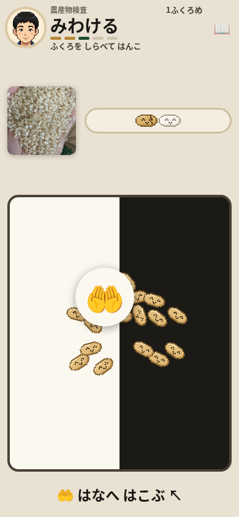
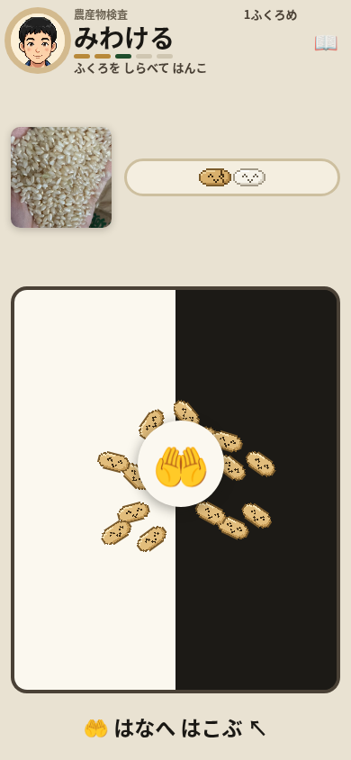
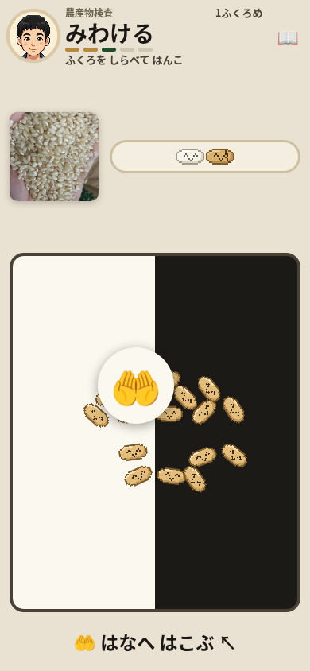
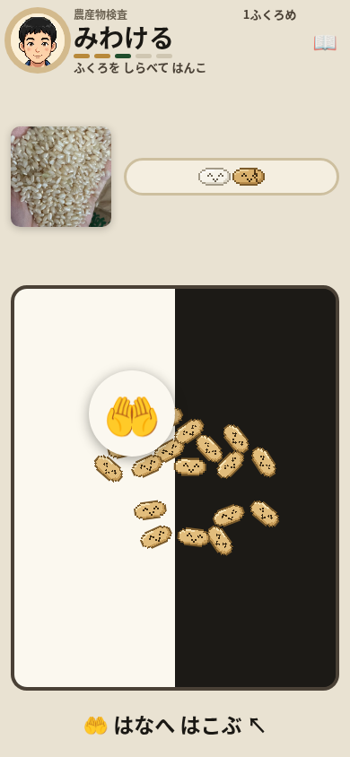

# 検査ゲーム：運んでいる指を別の指で取り替えない

最初の「はなへ はこぶ」で、動かしている指を離さずに別の指を品物へ置くと、続きを運んだ品物が右下へ戻った。操作と結果が合わず、最初の運搬の成功前に操作を諦める理由になり得る。修正前の固定再現では 10/10 回、速い操作・遅い操作とも 5/5 回で発生した。離脱率そのものは測っていない。

運び始めた pointerId を保存し、別の指の down / move / 終了でその運搬を取り替えないようにした。操作中の指が capture を失った場合は取消として片付ける。6 px を超える前の持ち替え、ID のない内部取消、にぎる操作、顔までの半分・近接の判定、空振り時の促しは保つ。変更は [kensa.html:2193](https://github.com/shota0617/ricepia-judge/blob/0db33b79106e220f49b06dd9099784d43a9029b8/kensa.html#L2193)、終了処理は [2229 行](https://github.com/shota0617/ricepia-judge/blob/0db33b79106e220f49b06dd9099784d43a9029b8/kensa.html#L2229)、capture 喪失は [2255 行](https://github.com/shota0617/ricepia-judge/blob/0db33b79106e220f49b06dd9099784d43a9029b8/kensa.html#L2255)。

| 同じ基準で数える項目 | 修正前 | 修正後 |
| --- | --- | --- |
| 別指を静止して追加した 10 回 | 10/10 回で戻る | 0/10 回 |
| 速い操作 / 遅い操作 | 5/5 / 5/5 回 | 0/5 / 0/5 回 |
| 保持中の期待位置との差 | 全対象で x +54、y +54 CSS px | 全対象で x 0、y 0 |
| 別指を追加しない対照 | 0/2 回、残差 0 | 0/2 回、残差 0 |

修正前は `4568c8792f4c804cf354f6f63a12ef568e2b6748`、製品と追加テストを含む候補は `0db33b79106e220f49b06dd9099784d43a9029b8`。候補の資料追加後の HEAD で全体検査を行ったとは扱わない。製品・テストの SHA と各検査の実行対象は [results.json](results.json) に記録する。

## 通常の最初の 1 分

修正前に localhost の `/kensa.html` を Chromium、390×844、isMobile / hasTouch、CPU 1、新規 context で開き、約 10 秒見てから CDP `Input.dispatchTouchEvent` で 60 秒遊んだ。外部通信は遮断し、外部部品の置換は不要だった。

| 操作開始からの時刻 | 記録したこと |
| --- | --- |
| 0.010 秒 → 0.171 秒 | 最初の操作 → 次の指示の初標本。差は 0.161 秒 |
| 3.4048 秒 | 初めての肯定的な表示「ちょうどいい」の標本 |
| 8.428 秒 | 「きれいに なった！」を操作後の DOM で確認 |
| 15.536–15.539 秒 | 1 袋目完了後の可視「次の袋」を確認 |
| 16.5237 / 38.1048 秒 | 2 袋目 / 3 袋目の表示標本 |

35 操作に 35 件の反応記録、反応なし 0/35、490/490 CDP ACK、trusted pointer 501 件、console / page / driver error 0。反応には表示変更も含み、全操作の工程進行を意味しない。肯定文や DOM の標本時刻は、人がごほうびを感じた時刻や物理的な表示遅延ではない。

修正前の通常プレイの原写真：[観察終了](primary-observe-10s.png)・[プレイ 10 秒](primary-play-10s.png)・[30 秒](primary-play-30s.png)・[60 秒](primary-play-60s.png)。60 秒写真の要求は 59.999 秒、保存完了は 60.064 秒。固定写真から手本の理解や人の継続率は判定していない。

方法成績は、通常プレイを見た A（DOM）・B（原写真）の新規確定がそれぞれ 0 件。C（入力処理の経路から立てた仮説）の C1 を pilot、その後の速度違い 10 回で 1 件確定し、今回は C を採択した。他の担当者による同じログの読取を、別のブラウザ実行回数へ加えていない。

## 再現手順と数え方

1. 新しい process/context で同じ画面条件を使い、無操作の後、可視の手本どおりに「さす → ひきぬく → 水分計を回す → 皿を広げる → 粒を 2 回取る」と進む。内部の工程変数は変更しない。
2. 初めての「🤲 はなへ はこぶ ↖」で、まだ運んでいない token の中心に P1 を置く。4 段階で左上へ −24,−24 CSS px 動かす。
3. 対象だけ、移動後の token 中心から −30,−30 の円内へ P2 を置いて静止する。P1 を同じ方向へさらに −24,−24 動かす。
4. 全指を保持したまま原写真・座標・transform を記録し、その後全指を一緒に解除する。期待位置は初期中心の −48,−48。x または y の残差が 8 CSS px 超を発生と数える。

速い区間は要求待機 40 ms（4×10）、遅い区間は 700 ms（4×175）。前後とも各速度の対照を 1 回、その後対象を速い・遅いの交互で各 5 回実行した。修正前の対象の実区間所要時間は速い方が 66.86–115.33 ms、遅い方が 732.58–835.05 ms。修正後は 66.64–301.11 ms / 730.99–930.10 ms。これには ACK 待ちや記録が含まれ、要求待機と同一視しない。大きな所要時間も除外していない。修正前の測定は操作開始から 10.035–11.730 秒で、すべて最初の 1 分内だった。

実 pointerId は trusted down の順・位置・対象から対応づけ、CDP の番号と同一視しない。P1 の実終端配送と同じ token への move、P2 の移動 0、円内 hit、顔への半分未達・近接未達、写真前後の位置安定を確認した。配送待ちは passive な入力記録だけを見ており、品物が期待位置へ移動するまで待っていない。前後それぞれ全 12 枠の実 exit は 0、不成立 0、自動再試行 0。

初期診断 v1 は対照 1 回が配送遅れによる撮影前後の位置変化で不成立（exit 2）、対象は未実行。改善した計測 v2 の対照 1 回・対象 1 回は固定 10 回へ足していない。観察写真の要求記録が 9,999 ms だったのは修正前 3 枠（fast-2 / slow-2 / slow-5）、修正後 1 枠（fast-3）。保存完了と最初の入力は全枠 10,000 ms 以後だった。この記録境界は保持し、製品の不具合や分母変更には扱わない。

## 検証

| コマンド・範囲 | 実結果 |
| --- | --- |
| 追加テスト：修正前 HTML | 1 unittest メソッド内 56 ケース：24 挙動失敗・32 成功・fixture error 0、exit 1 |
| `python3 tests/test_kensa_sense_drag_owner.py`：候補と同じ製品・テスト bytes | 同じ 56 ケースがすべて成功、exit 0 |
| `python3 -m unittest discover -s tests -p test_kensa.py -v` | 初回 190 成功・2 skip。既存のローカル Chromium hook を付けた実行で 192 成功・skip 0、exit 0 |
| `pytest tests/` | exit 127、`bash: line 1: pytest: command not found`。テストは実行されていない |
| `python3 -m unittest discover -s tests -v`（ローカル Chromium hook） | 2578 メソッドを直接照合：2508 成功・68 FAIL・1 ERROR・1 skip。実 child / outer exit 1。unittest 計時 470.189 秒、process 計時 475.696 秒 |
| 同一手順の修正後 12 枠 | 全枠実 exit 0・適格 12。対象 0/10・対照 0/2。独立監査でも入力・判定の同一性と前後の原写真 120 枚を確認 |
| 320×568・390×844・568×320・844×390・820×1180 | 修正後 5 枠すべて実 exit 0。175 操作 / 175 反応、525 layout 記録、原写真 20 枚。状態が一致した 449/525 記録で中央 hit 分類・画面外の悪化なし。76 記録は比較不能 |

追加テストは [tests/test_kensa_sense_drag_owner.py:360](https://github.com/shota0617/ricepia-judge/blob/0db33b79106e220f49b06dd9099784d43a9029b8/tests/test_kensa_sense_drag_owner.py#L360)。製品から実 handler と関連処理を抽出し、DOM と時計を代用して 2・3 本指、touch / mouse / pen、持ち替え、取消、capture 喪失、blur / hidden、ID なし終了、既存の運び・にぎり・キーボード境界を確認する。実ブラウザの再現とは別の検証である。既存テストは変更していない。

全体テストの不合格内訳は変更ファイルの範囲の期待 65 件、にしおの export 文字列の期待 2 件、トラクター進行の期待 1 FAIL・1 ERROR。69 件はそれぞれ別のメソッドで、subTest の重複ではない。同条件の修正前 baseline を実行していないため、失敗をすべて既存のものとみなさない。ほかのテストを消す・ゆるめる対応はしていない。

5 画面は R96 の保存済みの同一修正前 HEAD の記録と照合し、過去の実行を今回の新規実行回数へ足していない。前後とも各 175 操作・525 layout 記録で、修正後の横方向 overflow と可視 control / gesture の画面外矩形は 0。重なり 0 は `head/plate`、`head/hint`、`plate/hint`、`notesLink/hint` の保存 4 組に限り、拡大変形した `plateInner` は含まない。

修正後の可視 control 記録 1700 件のうち、能動 control 中央の遮蔽は 0 件。修正前の 4/1708 は横画面 2 枠のズーム解除中に資料リンクが覆われた記録で、4 → 0 を今回の改善には数えない。1700 は inert を含む DOM の中央 hit 標本数で、実際の押下回数ではない。状態をそろえられた 449 記録の 4856 item 比較で hit 分類・画面外の悪化はないが、そのうち 194 item は 0.5 px 超の座標差があり、個々のアニメーション時点まで一致させていないため、194 item の幾何同一性は未確認。残る 76 記録は state / zoom が違い比較不能。粒の clip や運搬 token の重なりをすべて不具合・今回の回帰とは扱わない。

同じ fast-1 枠の保持中の原写真。各枠は新規 context のため粒の配置は異なる。比較対象は品物の位置である。画像は加工せず原バイトをコピーした。

| | P2 を置く直前 | P1 をさらに左上へ動かした後 |
| --- | --- | --- |
| 修正前 |  |  |
| 修正後 |  |  |

原証拠の識別子・SHA・写真の要求 / 保存時刻は results に記載し、作業場の保存先を公開リンクのようには扱わない。

## 判断待ちと限界

運営者の判断：初タップで進む規則、つまむ / きめるの自動進行、45 秒カード、見せるだけの遊びの形、次袋の目標や報酬の追加は変更しない。別候補の等級操作の複数指・次袋ボタンの別指終了は未再現で、この変更へ含めない。新しい検査・農作業の事実は追加していない。

傾きセンサー・本物の指・回線速度は実機未確認。短い保持位置の写真は位置の戻りを支えるが、連続描画の初発時刻や自然な操作での発生頻度は未測定。人の最初の 1 分の離脱率も未測定。

この変更は運搬中の指の扱いに限定する。capture 失敗・喪失後に別指が外側で離れる場合、同じ pointerId の buttons=0 の hover、にぎる操作の複数指まで、あらゆる入力問題を解決したとは扱わない。

必須 `pytest tests/` が実行できず、全体 unittest も不合格のため draft を維持し、マージ・公開を保留する。[ricepia-flow/SKILL.md:212](https://github.com/shota0617/ricepia-judge/blob/0db33b79106e220f49b06dd9099784d43a9029b8/.claude/skills/ricepia-flow/SKILL.md#L212) の「テストが 落ちている・運営者の 判断が いる 変更は、マージせずに 伝える」に従い、未実行を成功に読み替えない。
