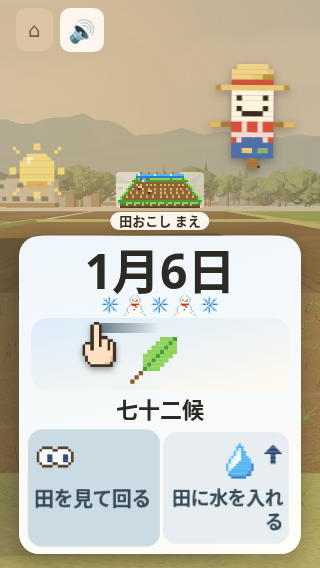
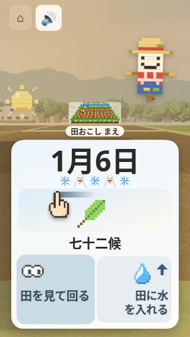

# R138 米づくり365：狭い画面の選択札を読みやすくする

**draft PR用の検証資料は完成。本番マージは、必須のpytest全体確認ができていないため保留。**

320×568の最初の1分で「田に水を入れ／る」「株を拾ってみ／る」と、選択札の末尾1字が次行へ孤立していた。幅301～359pxの札へ `text-wrap:balance` を1行追加し、元文と19pxの文字を保って折り返す。実操作10回では末行1字が **10/10 → 0/10** になった。人の理解・読解時間・離脱率への効果は測定していない。

[変更CSS](https://github.com/shota0617/ricepia-judge/blob/codex/firstminute-round138-current/kome365/index.html#L616)は1行、[追加UI回帰テスト](https://github.com/shota0617/ricepia-judge/blob/codex/firstminute-round138-current/tests/test_kome365_firstmin.py#L2153)は99行・2ケース。既存helper・既存テスト・保護3ファイルは維持した。0.3秒の手本、素早いスワイプ、タップ非選択、理由2秒と初3枚持続、30秒カード、音による時間不変も変えていない。

| 確認 | 結果 |
|---|---|
| 320×568・実操作10回 | beforeは全6＋1字、afterは全3＋4字。前後とも適格10、除外0、120msと600msを各5試行 |
| 同側・同速度のfont／箱／本文 | after10件をbefore4件の同側・同速度へ対応させ、意図した折返し指定以外のfont、全offset箱、元文が一致。独立seedのため1対1の同一内容軌跡ではない |
| 追加UI試験2件 | 実旧HTMLで2 RED、同じテストの候補HTMLで2 GREEN。1月6日6＋1→3＋4字、1月12日6＋1→4＋3字。全文7字・19px・2行、font/箱一致、幾何学上clip 0 |
| 関連既存5クラス | unittest 18件成功、失敗・error・skip 0、実child/outer 0/0 |
| 5画面＋境界4幅 | 前後9サイズを独立比較、各36原PNG・126札。320幅は6＋1→3＋4、301幅は5＋2→3＋4、他7サイズの対象は7字1行。同本文112対応でfont数値・札寸法差0、可視home/soundの198対応点で矩形差・中心hit失敗0。確認した画像・採取範囲で新たな悪化は未確認 |
| 必須 `pytest tests/` | 実終了127、コマンド不在、実行0件。関連18件の成功を全suite成功へ置き換えない |

一次観察は10.153秒観察＋60.001秒操作。11入力すべてで日付が変化し、記録したDOM反応なしは0、○4／✗7だった。最初のDOM反応は入力から67.1～538.9ms（中央値358.5ms）。最初の○は3操作目、操作開始から15.8054秒、その入力から851.3ms。初肯定までの15.8秒には台本の待ち時間も含む。手本が見えず見送った10機会は未送信で、入力失敗に数えない。これらはDOM観測で、画面に描かれた正確な瞬間や人が理解した時刻ではない。時計基準の差と全試行の値は[results.json](results.json)に残した。

再現は新しいcontext・空の保存・320×568で10秒観察し、画面内100pxのCDPスワイプを右・左・左・左・左の順に5回行って1月6日の元文を字別Rangeで測る。120ms/600msを交互に10試行。事前確認による開始遅延を許すため一次観察の絶対時刻の再演ではない。対象の側はbefore右6/左4、after右4/左6で、札の内容に応じて入力方向を変えていない。実3D・音処理の稼働は記録した。保存復元による追加UI試験はfake音/no3dで、実操作10回とは別の補助検証。

測定基準は `9e4bb385`。コードcommit `2965c1c1` とmain取り込み後の `f55262f3` でも、対象HTML・テスト・保護3ファイル等8件は測定時と同byteであることを確認した。HTML SHAは `633225944850825e08967b95975be9767b9341447379b6e8623a8680ade06003`。他ゲームへ取り込まれた変更を再試験済みとはしていない。

写真は[一次観察10秒](primary/observe-10s.png)、[操作10秒](primary/play-10s.png)、[操作30秒・1月6日](primary/play-30s.png)、[操作60秒・1月12日](primary/play-60s.png)と、下の比較2枚。すべて原byteとSHA一致。比較は前後ともtrial02・右札・600msで、全10試行の集計を代表写真で置き換えない。

| before：6＋1字 | after：3＋4字 |
|---|---|
|  |  |

両方とも1月6日「田に水を入れる」。手本アニメの位相が異なるため、手の写り方を表示時間の変更とは解釈しない。

実操作の前後10回は各favicon 404が11件、9画面は前後とも404が各2件/サイズ（consoleにURLがないため対象は未特定）。これらの実child/outerは1/1で、計測成立と全体成功は分けた。ラベル自身の上端をRangeが越える計数は保持し、親札・画面外やclip祖先の欠けとは分ける。原PNGとRangeは同時フレームではない。初期の計測案で起きた入力時刻の扱いと過大DOM採取の問題は診断記録とし、有効10回やゲームの不具合へ合算していない。

別候補として、568×320の理由と選択札アイコンの重なり、300×568の回答6で次カードの題「種もみの注文」付近を覆う所見が前後とも残る。日付・選択肢文字は読め、10回再現は未実施。本変更へ混ぜず、確定した表示時間等を保つ別の改善候補にする。傾きのセンサー・本物の指・回線の速さは実機では未確認（米づくり365の選択はスワイプのため、傾きは今回の操作対象外）。スピーカー実聴と端末ごとの実フォント差も未確認。`text-wrap` 非対応環境では従来の折返しに戻る。運営者判断を要する確定仕様の変更は今回含まない。

ユーザー提供GMTK239章はチームで提供分を読了（未読0）。原動画視聴・完全原字幕との照合は未実施。この変更には[115章](https://www.youtube.com/watch?v=vi98rAn4uXE)・[134章](https://www.youtube.com/watch?v=ObhvacfIOg0)・[147章](https://www.youtube.com/watch?v=xrqdU4cZaLw)の「文字を小さくせず読める」「読む負担を抑え判断を残す」という原則を使った。他作品の文・絵・音・実装は移していない。
