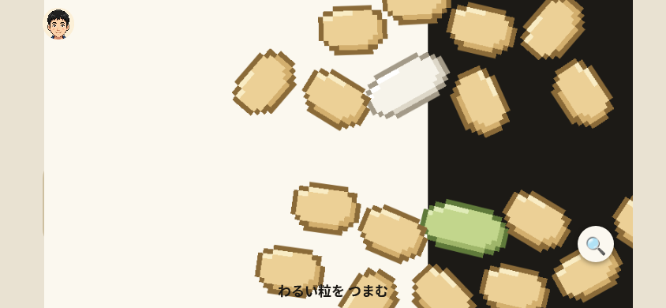
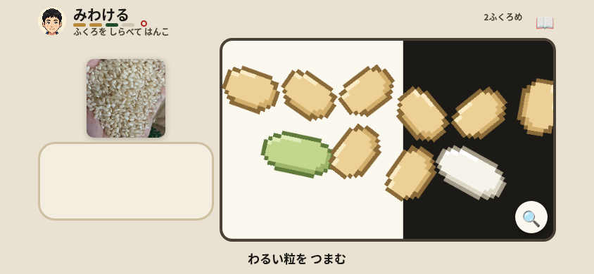

# R140 検査 — ズームを戻す途中も皿内に収める

**レビュー用draft・本番マージ保留。** 拡大を戻す瞬間に工程名や袋番号が隠れると、次の操作を見失うおそれがある。`kensa.html`にCSSを1行追加し、450msの滑らかな遷移を保ったまま中身を皿内に収めた。同じ縮小操作を前後各10回行い、皿外描画・ヘッダー遮蔽のある操作はともに**10/10→0/10**。離脱率や人の理解度の改善は未測定。

変更は検査ゲームのこの1件だけ。製品commitは `cd5f14d8049e991acc75b4cdabd19a268e944639`、基準mainは `22c91e2c`。[追加CSS](../../../kensa.html#L128)は `#plate:has(#plateInner.smooth) { overflow:hidden; }`。新しい回帰は1メソッド・3モード、186行。拡大の動き、入力、音、判定、進行は変更していない。

## 前後の原画像

|変更前|変更後|
|---|---|
|||

各相の縮小op02（600ms）、指を離した直後に要求した未加工PNG。同じ描画フレームや同じ乱数seedの比較ではない。写真とは別に採取した遷移フレームを計数した。

## 再現と変更箇所

1. 844×390・空保存で10秒観察後、可視手本に従い2袋目の「みわける」まで進む。
2. 拡大が静止し、可視の➖ボタンが押せることを確認する。
3. その中心を120/600ms各5回で縮小。間の拡大準備9回は120ms固定で別計数し、毎回表示の静止を待つ。

旧版は論理倍率が1になるとclip用classが外れるが、描画は450msかけて戻る。原因参照は旧版kensa.html:127/130/1703/1716/1739。追加した128行はsmooth中にもclipを維持する。通常静止時のoverflowを常時変更する修正ではない。

## 結果と保留

|確認|結果|
|---|---|
|同一セッションの反復、各相1セット|縮小10＋準備拡大9、全19入力をtrustedイベントと照合。採取十分10/10ずつ。両相actual exit0。|
|皿外／ヘッダー遮蔽|陽性操作は各10→0。陽性frameは128→0／98→0（各相post-release計370 frames）。|
|追加回帰|旧版1メソッド・3モード中2 subtest失敗→修正版1メソッド・3モード成功。pageerror0。consoleは未観測。|
|5サイズのfixture|全5で十分な採取。皿外hit frame計68→0（対象frame68→67）。静止3状態×5の要素/文字は一致、比較issues0。|
|既存テスト|変更前後ともdistinct206件＝205pass・同じ1fail・0skip。追加回帰とは別計数。|
|必須 `pytest tests/`|変更後もCLI不在、actual exit127、実行0件。全体合格とはしない。|

実行したコマンドは `pytest tests/`、新規回帰の `NODE_PATH=/workspace/ricepia-judge/node_modules CHROMIUM_EXECUTABLE=/usr/bin/chromium KENSA_REQUIRE_BROWSER=1 KENSA_ROOT=/workspace/ricepia-firstminute-round140 python3 tests/test_kensa_zoom_clip.py -v`、既存確認の `NODE_PATH=/workspace/ricepia-judge/node_modules PLAYWRIGHT_BROWSERS_PATH=/workspace/scratch/first-minute/round-140/local-browser-cache python3 -m unittest discover -s tests -p test_kensa.py`。旧版回帰は同じテストを旧HTMLへ向けて実行した。ローカルの依存物・実行場所は環境に合わせて読み替える。

残る失敗は `test_cycle163_last_step_dot_is_a_stamp_ring`（tests/test_kensa.py:4326、320×568/no-preferenceでglyph8≠0）。変更前から同じ失敗で、テストを変更・除外していない。[運用規則213行](../../../.claude/skills/ricepia-flow/SKILL.md#L213)のテスト失敗時の規則に従い、pytest不足と併せdraft保留とする。

反復前の自然な準備は各17操作、準備完了26.707/26.699秒、反復終了53.304/53.961秒。これは各相1contextの同一操作反復であり、10人の初回体験ではない。自然乱数も一致させていない。pilot1回、探索10試行（実対象6・全6で現象、未出現3・遅い到達で未入力1、outer exit1）は別枠で、反復10回へ合算しない。

## 最初の1分と画面

修正前primaryは10秒観察＋60秒操作、34操作に記録対象DOM反応、記録エラー0。play開始0.014秒に最初の入力、標本0.1763秒で「ひきぬく」。初肯定文言は(3.0057,3.1056]秒、押印後文言は(15.1056,15.2056]秒、2袋目番号は(17.5077,17.6288]秒、3袋目番号は(44.7057,44.8056]秒。これらはDOM標本の境界で、初描画・押印保持・袋アニメ完了時刻ではない。

原画像：[観察10秒](images/primary-observe-10s.png)／[操作10秒](images/primary-play-10s.png)／[30秒](images/primary-play-30s.png)／[60秒](images/primary-play-60s.png)。

修正後の縮小静止画像：[320×568](images/layout-after-320x568.png)／[390×844](images/layout-after-390x844.png)／[568×320](images/layout-after-568x320.png)／[844×390](images/layout-after-844x390.png)／[820×1180](images/layout-after-820x1180.png)。これはstage2を明示した粒非表示のfixtureで、各サイズの自然プレイではない。独立担当がAFTER20原画像を確認。既存のgoal Rangeの部分clipや横画面のh1非表示は前後同じで、実際の欠字とは断定していない。early画像は厳密な中間フレームで挟めておらず、rAF計数と分けて扱う。

## 保持事項と資料

運営者判断・既存ルールは変更なし。初回タップ非進行、つまむ/きめるの主体性、初袋救済、休憩カード、押印250ms、音・時間・判定・進行を保持。sourceの他9ファイルと既存test SHAは一致。説明文・音量UIの別案は延期する。実機の指・センサー・回線・音、個人の認知や離脱率は未確認。このChromiumは`:has()`対応だが、未対応ブラウザや古い実機での互換性は未検証。

根拠は既読GMTK134「[Improving Games for Those with Cognitive Disabilities](https://www.youtube.com/watch?v=ObhvacfIOg0)」の**提供文字起こし**1249行。章`[1493458,1502787)`、滑らかな遷移の引用`[1495242,1495310)`、文字を妨げない背景の引用`[1496971,1497070)`を、本件の「動きを保ち、重要UIを遷移中も読めるようにする」原則へ適用した。元動画は未視聴・未照合で、全文や他作品の素材は転用していない。

正確なSHA・計数・記録への対応は [results.json](results.json)、原PNGの一致は [asset-provenance.json](asset-provenance.json)。全11枚を加工せず収録している。
