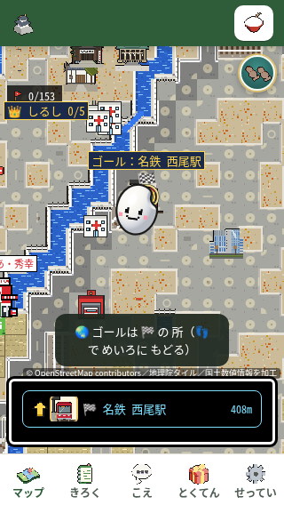

# R141 にしおさんぽGO — 戻るボタンを「戻る」と読める名前へ

世界地図の戻るボタンに、地図を開く側のアクセシブル名が残っていた。`pixel.js`へ1行を加えて配布minも同期し、実Chromium AX nameの不一致は同じ操作の前後各10回で**10/10→0/10**、歩く地図への復帰は**両相10/10**だった。名前で操作を探す人の判断を助ける狙いだが、人の理解・離脱率改善は未測定。

**draft保留。** 必須`pytest tests/`はCLI不在でexit127・実行0件、必須Node通し検査は完了したがexit1・終端判定10失敗（errors0）。選択した検証の成功を全体合格に置き換えない。

製品commit `cd677447877edb19b36841eec33ea136899c5497`（基準main `22c91e2c`）。[setWorldの追加1行](../../../nishio-go/pixel.js#L9258)はworld=trueで「歩く地図にもどる」、falseで元の「せかいちず（西尾市と となりの市町）」へ戻す。title、アイコン、位置、初回hidden、保存・入力・音・地図処理を保持する。元HTMLの市町説明を残し、新しい地理的事実は追加していない。

## 操作と実AX名

320×568の新しいcontextで10秒観察し、画面端の可視ゴール矢印から世界地図を開き、可視の戻るボタンを押す。これを10往復。入口は40ms固定、戻る操作は120/600msを交互に各5回。各相20入力のtrusted pointerdown/up/clickと、完全な1100ms観測窓を確認した。各相1contextであり、10人の初回体験ではない。

|世界地図中の実button|変更前|変更後|
|---|---|---|
|AX name|せかいちず（西尾市と となりの市町）|歩く地図にもどる|
|title|歩く地図にもどる|歩く地図にもどる|
|名前の不一致／有効観測|10/10|0/10|
|実タッチで戻る|10/10|10/10|

 

前後ともtrial2、600msの戻る操作前に撮った原PNG。画面の見た目は保持する変更であり、**PNG自体はAX名の証拠ではない**。AX値は同じbuttonのbackendNodeIdに対応するaccessibility treeから取得した。同一描画フレーム・同一seedの保証はしない。各10試行の要求時間、native間隔、AX名/title、復帰状態、観測窓、errorsは[results.json](results.json)に短い配列で収録し、元SHA・行動番号・抽出位置は[provenance.json](provenance.json)へ対応させた。

## 検証の範囲

|検証|結果|
|---|---|
|自然な可視矢印→戻るの反復v2|前後各10往復・20入力、AX誤り10→0、復帰10ずつ。両相actual exit0、記録エラー0|
|[追加回帰159行・1メソッド](../../../tests/test_nishio_world_ax.py#L155)|同一test SHAで、旧版はAX名assertionの1失敗→修正版1成功・exit0。実HTML/min・保存fixtureで実CDP往復。pageerror0、consoleは未観測|
|5サイズ×3状態の補助fixture|世界地図のAX不一致5/5→0/5。control115組/region90組の幾何・font・文字・title・hidden・中心hit等は一致、他AX差分0。初期/復帰10状態の旧名・hidden・ignoredを保持|
|既存関連4ファイル|前後とも32件中30pass・0fail/error・既存acorn不足2skip。4本のtest SHA不変。追加回帰とは別計数|
|必須検査|pytestは前後exit127・実行0件。Nodeは231終端条件中221通過・10失敗（skip許容2を含む）、exit1。全体未合格|

初回の旧回帰は、テストのnoauto設定が旧introを出して操作前に停止したもので、意図したREDではない。自然v1も対象到達1・復帰1・AX誤り1、未到達9の未完了探索として残す。初回NEWは結果収集のJSON解析でwrapperが失敗し子exit未保存のため、成功に数えない。その後、同一テストの別実行でchild/outer exit0を保存した。これらを前後10回や成功件数へ合算しない。

独立画像監査は前後各15原PNGを実見し、新規の配置・操作領域の不具合を確認しなかった。5サイズの世界地図原画像：

|サイズ|変更前|変更後|
|---|---|---|
|320×568|[原画像](images/layout-before-320x568.png)|[原画像](images/layout-after-320x568.png)|
|390×844|[原画像](images/layout-before-390x844.png)|[原画像](images/layout-after-390x844.png)|
|568×320|[原画像](images/layout-before-568x320.png)|[原画像](images/layout-after-568x320.png)|
|844×390|[原画像](images/layout-before-844x390.png)|[原画像](images/layout-after-844x390.png)|
|820×1180|[原画像](images/layout-before-820x1180.png)|[原画像](images/layout-after-820x1180.png)|

これは既存APIで世界地図へ入り実タッチで戻る補助fixtureで、自然10回には加算しない。canvas・動物・手本・トーストには実時刻差がある。390×844復帰後のOK表示などの写真差を含め、画素一致とはしない。

## 必須Node通し検査の未通過条件

通しの台本は終端処理まで進み、child/outer exit1・timeoutなし・`errors=[]`、`scriptStopped`なし。**終端判定231条件中221通過・10失敗**（通過数には既存skip許容2条件を含む）。253は保存されたgroup数で、テスト成功数ではない。skipは `yuruMeiro: no-route` と `mzSameCellGoal: no pair`。

|条件キー|原記録で不成立だった点|
|---|---|
|`godotRec`|影の記録 shade=0（errs=[]、描画命令 len=5957）。例外停止の記録ではない。|
|`swipeHold`|保持中の g4 が指定先 want と異なり、離した後の g3 も g4 と異なる。|
|`restFinger`|別の指を置いた条件で tap=false / swipe=false。pinch・touch-action 条件は通過。|
|`tiltDemoShown`|1.5度の模擬入力後 on=false / phone=false。force=0.28 は閾値を満たす。|
|`tapDemoQuick`|手本待ち中央値3201ms（7観測）が1700ms未満の条件を満たさない。|
|`lowGoalDemo`|4条件のうち568×320・残り1マスで手本未表示。他3条件は通過。|
|`rollNoDemo`|模擬8度入力後 vmax=0、fresh=true。走行中の手本重なりを示す記録ではない。|
|`infoSecondTap`|前提の名所窓が開かない（win.open=false）。窓内の二度押し誤作動は未確認。|
|`infoRotate`|tablet条件で前提の窓が開かず、閉じるタッチも未発行。phone条件は復帰まで通過。|
|`speedLines`|移動距離 far=0.96 が1.5超に届かない。線は0、最大速度4.16の条件は通過。|

これは検査条件の不成立10件で、確定した製品不具合10件という意味ではない。同条件の変更前通し検査との比較がなく、今回の1行との因果は未確定。全失敗文と253groupは原本と同byteの [node-playtest.json](node-playtest.json)、判定式・型別集計・出典SHAは [results.json](results.json) / [provenance.json](provenance.json)で確認できる。実行前後のsource336/deps550は同一、終了後ブラウザ0・port8899接続拒否を確認した。

## 実行コマンドと配信条件

以下は保存した記録に対応するコマンド。cwdは `/workspace/ricepia-firstminute-round141`。追加回帰の旧/新は同一test SHAを使った。

```sh
NISHIO_ROOT=/workspace/ricepia-firstminute-round141 \
NODE_PATH=/workspace/ricepia-judge/node_modules \
LEAFLET_DIR=/workspace/ricepia-judge/node_modules/leaflet/dist \
CHROMIUM_EXECUTABLE=/usr/bin/chromium \
python3 tests/test_nishio_world_ax.py -v

NODE_PATH=/workspace/ricepia-judge/node_modules PYTHONDONTWRITEBYTECODE=1 \
python3 -m unittest tests/test_nishio_min.py tests/test_maze_loop4_191.py tests/test_maze_loop4_200.py tests/test_maze_loop4_147.py -v

pytest tests/

NODE_OPTIONS=--require=/workspace/scratch/first-minute/offline.cjs \
NODE_PATH=/workspace/ricepia-judge/node_modules \
CHROMIUM=/usr/bin/chromium \
LEAFLET_DIR=/workspace/ricepia-judge/node_modules/leaflet/dist \
PLAYTEST_PORT=8899 PYTHONDONTWRITEBYTECODE=1 \
node tools/playtest.js /workspace/scratch/first-minute/round-141/full-node-runtime/artifacts
```

pytestの実出力は `bash: line 1: pytest: command not found`、exit127・実行0件。Nodeはwrapperが起動する上記child commandで、通し検査は完了し、child/outer exit1・timeoutなし。10失敗とerrors0を別に数える。 実際の起動管理は `python3 /workspace/scratch/first-minute/round-141/required-checks-prep/run_node.py`。wrapper/preloadはこの環境のscratch資産なので、他環境では同等の外部遮断とローカルLeaflet配信を用意する必要がある。

通常プレイではLeaflet 1.9.4のCDN要求を手元のdistへroute差替えし、外部フォント・気象・標高の4種類のURLは空204で返した。外部URLの正確な一覧はresults.jsonへ収録。console/pageerrorはいずれも0。外部地図/気象サービスを通常回線で利用した確認ではない。

## 最初の1分・保持事項・資料

通常primaryは10秒観察＋60秒操作、16入力に記録対象の応答があり、世界地図へ3回・戻る3回。初ポイント30はplay0.1201001秒、入力後104.1001msの**可視DOM観測**。初座標変化は0.1205秒／104.5msで、異なる観測streamによる値。初描画・人の理解や離脱改善の時間ではない。その後、保存goal=1の初観測は23.7292秒、世界地図との3往復を経て60秒内の最終観測は478ポイントだった。原画像：[観察10秒](images/primary-observe-10s.png)／[操作10秒](images/primary-play-10s.png)／[30秒](images/primary-play-30s.png)／[60秒](images/primary-play-60s.png)。この4枚は全て歩く地図で、AX測定とは別。

運営者判断の新規候補0、既知保護事項の変更0。傾き、最初の本当のclickでの許可（拒否済み・二重要求条件を含む）、タップ/停止手本、開始画面なし、到着カードなし、保護3ファイルを保持。実機の指・センサー・読み上げ・回線・音、人の発見や継続率は未確認。

既読GMTK78「[How Accessible Were 2021's Games?](https://www.youtube.com/watch?v=-IhQl1CBj9U)」提供本文834行・`[914283,914367)`のmenu narrationを含む情報経路のアクセシビリティと、GMTK87「[Can we Improve Tutorials for Complex Games?](https://www.youtube.com/watch?v=-GV814cWiAw)」899行・`[1003322,1003435)`の必要な場面で情報を届ける原理を適用した。ARIA/CDPは今回の製品調査で選んだ方法。元動画は未視聴、提供本文の欠落は補っていない。全文・他作品の素材・固有実装は転用していない。
