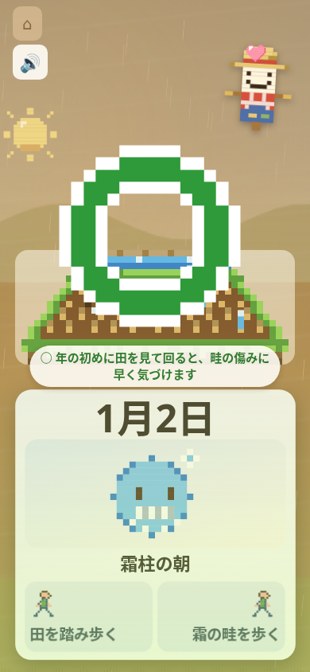
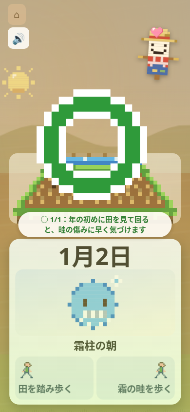

# R142 米づくり365 — 理由に回答日を添える

**draft／全体検査未実行のため本番公開HOLD。** HTMLは `0b918e87…`。最終の同一266行テストは旧版3メソッド失敗→変更後3成功。既存17件も前後成功し、変更後の関連テストは別実行の計20件成功。独立監査では回答日表示が10回反復0/10→10/10、5サイズ0/15→15/15。必須pytestはCLI不在・exit127・実行0件で、全体通過とはしない。

次の日付のカード上に残る理由へ、回答した月日を「○ 1/1：本文」のように添える。理由は既に行為を説明しているが、日付を加えて回答と結果の対応を読み取れるようにする。人が混乱した件数や離脱改善は測っていない。1ゲーム・理由の識別表示1件。

[回答前のd0](../../../kome365/index.html#L3907)を[whyShow](../../../kome365/index.html#L3871)へ渡す。[CSS](../../../kome365/index.html#L658)は `text-wrap:balance` を追加し、[高さ440px以下](../../../kome365/index.html#L659)だけ最大幅を `calc(100% - 8px)` とする。元の第一文・○/✗・15px・2秒・初3枚持越し・入力・配置判定ロジックは保持する。実際の文字高や位置の完全一致は主張しない。

|検証|旧版1131|候補0b918|
|---|---|---|
|追加回帰・最終同一266行|3メソッド失敗。日付12＋横画面4＋末行2字1＝17 failure entries、6.707秒・exit1|3メソッド成功、6.732秒・exit0|
|5サイズ・各初3回答|回答日0/15、応答15/15|回答日15/15、応答15/15。両版geometry違反0・console error6・exit1|
|390×844・10回答|回答日0/10、応答10/10|回答日10/10、応答10/10。両版geometry違反0・console error2・exit1|
|既存why7＋MarkClear10|17成功、fail/error/skip0|17成功、591.811秒、fail/error/skip0・exit0|
|必須pytest|command not found、exit127・0件|command not found、exit127・0件|

geometry違反0は日付・左右札への判定で、大きな○や題名との重なり全体を否定しない。5サイズは320×568、390×844、568×320、844×390、820×1180。各セッション10秒観察後、可視カードを左右交互に初3回答する実入力で、保存値や本文を注入するfixtureではない。console本文にURLはない。別のローカルserver記録では候補の404計8件すべてが `/favicon.ico` の404と同じUTC秒に一致するが、request IDによる一意な帰属ではない。pageerrorは0、全5contextとbrowserは閉鎖済み。

10回反復は390×844、左右交互、予定120/600msを各5回。native実間隔は候補120–125ms／600–607msで各5回。全件trusted touch・日付進行・DOM可視理由を確認。同じ人10名の実験ではなく、別セッション・乱数未一致。同文6組（1/2/3/5/6/7）は行数不変、本文が違う4組を改行効果の比較から除外する。

[追加回帰](../../../tests/test_kome365_why_date.py)は実advance/whyShowを使う日付VM fixtureと、実DOM Rangeで読む390縦・568/844横の改行fixture。固定6日×正誤の全文、冬/収穫後の暦、末行4字以上、横の初3本文の全文/15px/1行/画面内を検査する。本文注入・人工resize・可視待ちを使い、自然選択や実2秒保持の証拠とはしない。既存helperはfake audio/原則no3d（MarkClearの1planのみ3D）。既存署名assertはd0まで完全一致へ更新し、○/✗両側・NG限定禁止・2秒の条件を保った。最終テストSHAは `6bd608f1…`。同byteで保存旧HTML1131と変更後0b918を検証した。

通常primaryは基準HEAD `71bd05c991ba0e2715f687393081b997e3259648` で10秒観察＋60秒操作。9入力すべてに記録対象応答と日付進行、理由○4/✗5、回答日記載0/9。console/favicon404各2でouter exit1、pageerror0。最初のDOM応答67msは実描画や人の理解の測定ではない。このprimary・反復・5サイズ・回帰は別計数。 初入力はplay開始+0.252秒、最初のDOM応答は入力+0.067秒、初回理由のcomputed可視は入力+0.8513秒。最初の○の理由はplay+16.6746秒（第3入力+1.5136秒）にcomputed可視となり、記録上の無反応は0。これはstyle/DOMの代理観測で、人の知覚・ごほうびの感じ方ではない。play時刻はNode epoch換算で、別の10回反復との速さ比較はしない。30秒画像は1月5日の理由と1月6日のカード、60秒画像は1月9日の理由と1月10日のカードを示す。

独立画像担当が候補31原PNGを全実見。横2画面の初3理由は旧と同じ1行・高さ31pxで、568回答1の大○への重なり増加は当該写真では確認しない。既存のアイコン/題名/田の状態表示との重なりは残る。820×1180の最初2理由は1→2行・31→52pxとなるため、全画面の行数不変とはしない。理由が読める反復写真は7/10で、DOM可視10/10とは別。最大tick gapは候補反復7080.4ms・5サイズ9548.9msあり、実画面で連続2秒表示された保証ではない。

|変更前：回答日は書かれていない|候補：1月1日の回答と次の1月2日のカードを区別|
|---|---|
|||

同じ左120ms・同じ理由本文の別実行画像。天候や演出位相は一致させていない。次は各サイズの初回答（同じ理由本文）の原画像。行数は可視DOM測定で、写真が薄い/消えた時点も含む。既存アイコン等の重なりは残る。

|画面|旧画像|候補画像|理由の行数（旧→候補）|
|---|---|---|---|
|320×568|[旧](images/layout-before-320x568.png)|[候補](images/layout-after-320x568.png)|2→2|
|390×844|[旧](images/layout-before-390x844.png)|[候補](images/layout-after-390x844.png)|2→2|
|568×320|[旧](images/layout-before-568x320.png)|[候補](images/layout-after-568x320.png)|1→1|
|844×390|[旧](images/layout-before-844x390.png)|[候補](images/layout-after-844x390.png)|1→1|
|820×1180|[旧](images/layout-before-820x1180.png)|[候補](images/layout-after-820x1180.png)|1→2|

5サイズの候補20原PNG全体の評価は、独立画像監査notes SHA `a31186a6…`／audit SHA `ef37e470…`（完全SHAと元パスは[results.json](results.json)）に記録。

原primary画像：[観察10秒](images/primary-observe-10s.png)／[操作10秒](images/primary-play-10s.png)／[30秒](images/primary-play-30s.png)／[60秒](images/primary-play-60s.png)。過去試作の成功数は本候補へ転用しない。

資料は既読GMTK82（[URL](https://www.youtube.com/watch?v=vFjXKOXdgGo)、提供855–860行）と104（[URL](https://www.youtube.com/watch?v=bm0S4cn_rfw)、1005–1016行）。自力で次へ適用する学習、選択・結果の対応を読める原則を使う。具体的な日付表示は今回の製品観察に基づく案。原動画未視聴、新規読了0、欠落本文は補完していない。

「肥料は稲に合わせて春から入れます。」は[既存cards.jsのkou_1](../../../kome365/cards.js#L462)の第一文。農業資料一覧は既存[showSources](../../../kome365/index.html#L2604)。農業本文・事実の追加はなく、外部の一次資料を今回新たに検証したという主張もしない。

**運営者の判断。** 理由の2秒や初3枚持越しを短縮・解除する案は、保護された仕様を変えるため採用しない。既存の再配置・0.3秒手本・素早いスワイプ・タップ非選択・音・30秒カード・かかし/太陽と保護3ファイルも保持する。primaryの5.218秒longtaskは原因未確定で、このPRでは保護対象field3d.jsを変更しない。新しい運営者判断の依頼0。実機のセンサー・本物の指・音・回線、他ブラウザのbalance互換性、人の読解・混乱・離脱効果は未確認。計数条件・原SHA・検証限界は[results.json](results.json)。

回帰実行は `python3 tests/test_kome365_why_date.py -v`。実環境は `KOME365_ROOT=/workspace/ricepia-firstminute-round142`、`KOME365_HTML`を旧保存HTML/候補HTMLへ切替、`PYTHONPATH=$KOME365_ROOT/tests`、`NODE_PATH=/workspace/ricepia-judge/node_modules`、`NODE_OPTIONS=--require=/workspace/scratch/first-minute/offline.cjs`。preloadはscratchのため別環境では同等の外部遮断が必要。必須コマンドは `pytest tests/`。実行記録と原結果はresultsのevidenceを参照。

既存17件は同じ環境で `python3 -m unittest -v test_kome365_firstmin.TestKome365WhyBothSides test_kome365_firstmin.TestKome365WhyReadable test_kome365_firstmin.TestKome365WhyFit test_kome365_firstmin.TestKome365MarkClear`。変更後17成功。追加3成功との計20は関連範囲の別実行合計で、pytestによる全体検査の代替にはしない。
