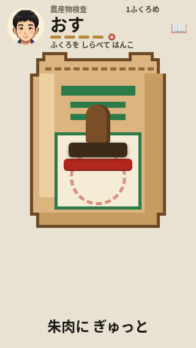
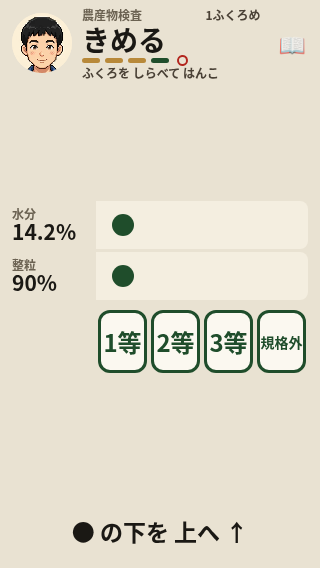

# R144 検査ゲーム — 等級を決める指を区別する

**draft／本番HOLD。** 同じ等級ボタンの2本指で、1pxしか動かしていない指が別の指の始点を使って確定する問題を、pointerの所有を確認する4行で修正した。同操作10回のrelease前誤進行は10/10→0/10。5サイズも5/5→0/5。必須pytestは未導入で0件、既存テストの既知1失敗も残る。

## 操作・期待・変更

意図していない等級決定は、自分の操作と結果の対応を分かりにくくする。最初の1分で操作への信頼を失う候補として、この1件を選んだ。人の離脱理由を実測したものではない。

リポジトリ直下で `python3 -m http.server 8000` を起動し、Chromiumで `http://localhost:8000/kensa.html` を開く（320×568、isMobile・hasTouch、CDP `Input.dispatchTouchEvent`）。10秒観察後、見える手本に従って初回「きめる」へ進む。手本が示す同じボタンの中央x・上端+10pxへAを置き、30px下にBを追加し、Aだけ上1px動かす。両指を離す前に測る。どの指も24px上へ引かず、2tapも完了していないため「きめる」を保持するのが期待値。旧版は「おす／朱肉にぎゅっと」へ進み、変更後は10回とも「きめる」に残った。

[変更箇所](../../../kensa.html#L2387)：最後のpointerdownを従来どおり始点にし、2387行でIDを保存。[move2390](../../../kensa.html#L2390)・[up2397](../../../kensa.html#L2397)・[cancel2404](../../../kensa.html#L2404)は同じIDだけを受ける。A→Bの後はBがowner。Aの1pxをBの位置から約31pxと計算することを防ぐ。B自身の24px上引きが有効なことは追加fixtureで確認し、owner終了後に残る指へ自動移譲はしない。別ボタンごとの状態・既存2tap・キーボード選択は維持する。

|両指を保持した同操作後・case01|旧版|変更後|
|---|---|---|
|A上1px／B移動0px|||

写真の状態差が今回の結果であり、同一frame・画素の比較ではない。

## 検証結果

|検証|旧版4f5f|変更後ad937|
|---|---|---|
|実入力10回、各fresh context|有効10、release前誤進行10、保持0、unknown0、exit1|有効10、誤進行0、保持10、unknown0、exit0|
|5サイズの同操作|有効5、誤進行5、exit1|有効5、誤進行0、保持5、unknown/error0、exit0|
|追加回帰・同一164行test|1メソッド、15シナリオ/31 checkpointのうち5 subtest失敗、exit1|1メソッド成功、31 checkpointすべて一致、exit0|
|既存test_kensa.py・最終再実行|206中205成功/既知1失敗/skip0、exit1|206中205成功/同じ既知1失敗/skip0、exit1|
|通常primary・観察10秒＋操作60秒|34操作/34記録応答、console/error0、exit0|34操作/34記録応答、console/error0、exit0|
|必須pytest tests/|CLI不在、exit127・0件|CLI不在、exit127・0件|

10回は予定120/600ms間隔を各5回。両版全件A最大1px/B0px、測定前up/cancel0、実nativeの2IDが同時activeで成立した。native timestampとlistener時刻は分離し、cleanup後の変化は加算しない。自然手本で初回等級へ進めてから明示した2指診断を加える測定で、10人の通常プレイではない。pilot1/1は別記録。5サイズは各1回・予定120msで、10回とは別母集団。両群のconsole/page/request/HTTP/case error0、browser/context閉鎖・root live0。

既存AFTER初回は204成功/2失敗だった。1件は旧guard全文を要求する[既存assert3244行](../../../tests/test_kensa.py#L3244)で、新owner条件を含む全文へ1行同期した。`!drag`/`pageFinger`や他の検査は削らず、最終206件を再実行して205成功/既知1失敗（37.775秒）。追加1メソッドと合わせ関連207中206成功/1失敗で、pytest全体成功ではない。ブラウザ記録はassert同期前のtest SHAで凍結済みで、履歴を書き換えていない。

[追加回帰](../../../tests/test_kensa_grade_pointer_owner.py)は実製品listenersを抽出するNode VM fixture。2/3指・異指up/cancel・離す順・単指23/24px・キーボード・誤答後の再選択・scroll・異指hover pen・次袋を確認する。DOM/音/配送/captureはstubで、実入力/描画/実機blurとは別証拠。同じownerのpen/mouseでupを失った後のhover、blur/hidden時のdrag自体の解除は範囲外。lifecycle項目は完了済み1tapの保持を確認する。

## 画面と通常プレイ

同じ「きめる」の接触前を比較した20等級ボタンのbox/textBox/fontは一致。変更後の接触前20個・両指保持中20個は画面内で中心hit一致。独立監査は旧接触前5＋新接触前5＋新保持中5の原PNG15枚を実見し、新たな切れ/遮蔽を認めなかった。別状態の旧「おす」と新「きめる」は配置比較に使わない。手本・dot・旧320/820の皿の残像には実時刻差がある。

|サイズ|旧・接触前|変更後・接触前|
|---|---|---|
|320×568|[原画像](images/layout-before-320x568.png)|[原画像](images/layout-after-320x568.png)|
|390×844|[原画像](images/layout-before-390x844.png)|[原画像](images/layout-after-390x844.png)|
|568×320|[原画像](images/layout-before-568x320.png)|[原画像](images/layout-after-568x320.png)|
|844×390|[原画像](images/layout-before-844x390.png)|[原画像](images/layout-after-844x390.png)|
|820×1180|[原画像](images/layout-before-820x1180.png)|[原画像](images/layout-after-820x1180.png)|

通常primary原画像：旧[観察10秒](images/primary-observe-10s.png)／[操作10秒](images/primary-play-10s.png)／[30秒](images/primary-play-30s.png)／[60秒](images/primary-play-60s.png)、新[観察10秒](images/after-primary-observe-10s.png)／[操作10秒](images/after-primary-play-10s.png)／[30秒](images/after-primary-play-30s.png)／[60秒](images/after-primary-play-60s.png)。全20枚を無加工コピーしSHAを記録した。

前後primaryは各34操作/35接触/488 CDP ACK。操作後最初のpoll応答は旧0.424秒/新0.425秒、肯定文「ちょうどいい」は旧3.357秒/新3.410秒、次袋は旧17.761/40.449秒、新17.728/40.509秒。新の通常48px上引き2回も各11.933/34.642秒のpollで「おす」へ進み、60秒は前後とも3袋目のみわける。pollはstyle/DOMの上限観測で、人の知覚や正確な描画開始ではない。入力座標列まで一致するのは18/34操作なので、速度改善・報酬早期化の因果を主張しない。通常pinch1回と同じ等級ボタンの2指診断は別条件。

## 根拠・保持・限界

既読GMTK104（[提供1005–1016行](https://www.youtube.com/watch?v=bm0S4cn_rfw)）の選択と結果の対応・主体性、78（[831–836行](https://www.youtube.com/watch?v=-IhQl1CBj9U)）の入力方式を分けた確認を適用。自分の行為に対応する結果を返す修正で、具体的なpointer実装を原動画が勧めたとは言わない。提供文字起こしを使用し、原動画の視聴は行っていない。人の混乱/離脱率の改善は未測定。

未決4仕様（初回tapで進まない、つまむ／きめるは自動で進まない、45秒カード、見せるだけの遊び形）、初袋完了前45秒カード禁止、既定2回空振りの範囲、250ms stampHold、実機決定を保持。新たな運営者判断依頼0。PR1203 plateclipは別件。実機センサー・本物の指・音・回線・支援機器は未確認。既知失敗は`test_cycle163_last_step_dot_is_a_stamp_ring`（320×568/no-preference、glyph8!=0、基準4326行）で、本件に起因すると主張しない。

実行コマンドは `python3 tests/test_kensa_grade_pointer_owner.py -v`（旧HTMLを別指定する場合は`KENSA_HTML`）、既存範囲は `python3 -m unittest discover -s tests -p test_kensa.py -v`、必須全体は `pytest tests/`。実エラーは `/bin/bash: line 1: pytest: command not found`（exit127、0件）。既存実行環境は`NODE_PATH=/workspace/ricepia-judge/node_modules`、`PLAYWRIGHT_BROWSERS_PATH=/workspace/scratch/first-minute/round-140/local-browser-cache`、`NODE_OPTIONS=--require=/workspace/scratch/first-minute/offline.cjs`。他環境では同じ依存・外部遮断が必要。原receipt・全SHA・20試行の短い配列は[results.json](results.json)。
