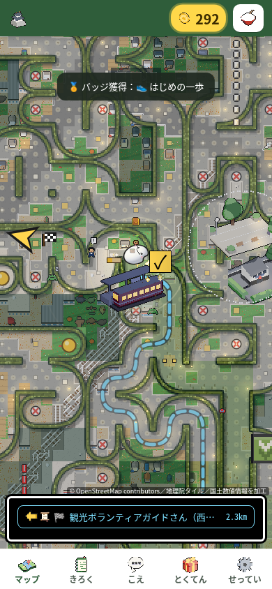
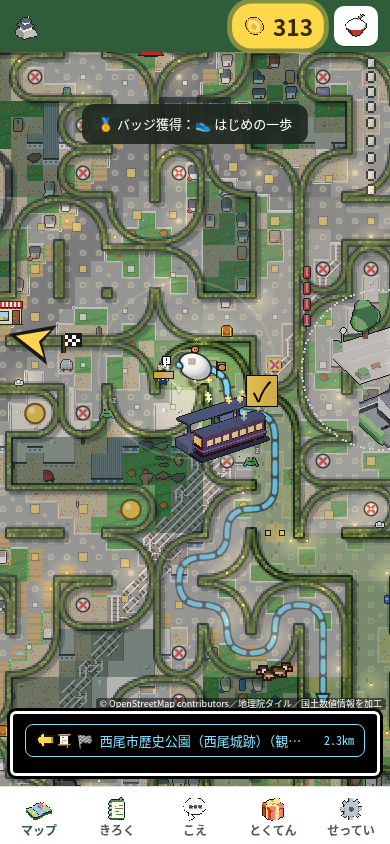

# R145 提出用候補：既知NPCの場所名を先にする

**最終報告候補・HOLD。** 自然repeat旧新10回と自然layout旧新5サイズ、追加回帰は固定済み。必須Nodeは231終端条件中219通過・12失敗、actual child/outer1/1で完了。表示fixtureは[独立章](fixture.md)にv1停止記録と完了v2の制約を分ける。製品commitは `69c0891a6c4be6a8057e01ff8f01034b1d49978f`、この報告は同製品HEADでの検証時点を固定した記録。本番反映は0で、下書きPRの現在状態はPR画面を参照する。 後続のmainは別actorの検査ゲーム変更で`6334d310`へ進んだとのroot記録があるが、R145の試験対象は製品HEAD`69c0891a`・base/merge-base`71bd05c9`のまま。後続mainのrebase/mergeは行わず、最新mainと同一条件の試験とはしない。

人物名から始まる案内札では、内部に括弧がある地名が既存の並べ替え対象にならず、狭い画面で場所名が読めなかった。`guideDispName`の現行2507–2510行へ4行を追加し、NPC id・非空の人物名/spotName・元の合成名がmetadataと完全一致する場合だけ「場所（人物）」を返す。regexは広げず、未知名・不一致・non-NPCのfallbackは維持する。

対象は既存の「観光ボランティアガイドさん」「西尾市歴史公園（西尾城跡）」で、元の名称を並べ替える。本文28codepoint、旗と空白を含む主名30codepoint、文字集合、1行、距離の表示を保つ。castle-guideのhardcodeではなく、条件に一致する既知NPCへ働く。主札・代替札・会話選択・選択後toast・arriveMsgの既存7呼出しに及ぶが、自然検証の主対象はcastle-guideであり、全NPCの実遊確認ではない。

|独立した確認|旧版|修正版|比較できる範囲|
|---|---|---|---|
|通常primary：390×844、観察10秒＋play60秒|10操作・記録無応答0・errors0、actual0|今回の同条件afterなし|初touch送信→座標変化/可視30点はどちらも約0.129秒のDOM proxy（physical paintや反応実感ではない）|
|自然repeat：予定10回ずつ|対象6、unknown4、actual0|対象6、unknown4、actual0|対象画像で場所名全文が読めない6/6→0/6|
|自然layout：5サイズ各1回|対象3、unknown2、actual0|対象1、unknown4、actual0|同じ対象の前後比較は820×1180のみ|
|追加回帰：同じ1メソッド21条件|canonical1失敗、actual1|成功、actual0|実helper/metadataのVM fixture。21メソッドではない|
|既存test205：元byte不変|8pass、actual0|7pass/1scope fail、actual1|失敗を削除・緩和・skipしない|
|必須pytest tests/|CLI不在、exit127、0件|CLI不在、exit127、0件|全体合格にはしない|
|必須全体Node|今回の旧版通しなし|231終端条件中219通過・12失敗、actual1/1|通過内whole skip3。自然playとは別|
|別の表示fixture|v1は1件で停止・受理0/9NOTRUN|v2は対象記録10/10・actual0|静止同条件pair0/5、自然母数へ合算しない|

自然repeatのunknownは各予定10回に残し、取り直していない。旧対象は1/2/5/7/8/9、新対象は1/3/4/5/6/8で、同じtrial番号・経路・時刻のpairではない。独立画像監査は終端20原PNGすべてを実見し、旧対象6枚の「観光ボランティアガイドさん（西…」に対し、新対象6枚は「西尾市歴史公園（西尾城跡）（観…」を確認した。**人物名の末尾省略は残り、案内名全体の全文表示になったわけではない。** 対象写真の距離はすべて2.3km。同じ文字集合・1行・名前矩形/fontを確認したが、Rangeは省略描画前の座標であり、読める字の判定は原PNG監査による。

旧対象trial01と最初の新対象trial01の代表画像（別経路・別frame）：

|旧|新|
|---|---|
|||

通常primaryのplay開始基準では最初の座標変化0.158300秒・可視30点0.157800秒。初touch送信を起点にすると129.2998ms/128.7998msで、いずれも約0.129秒である。raw精密値はresults.jsonに保持し、physical paint・音の知覚・人の反応実感とはみなさない。

各自然repeatは40ms/200ms指定を5回ずつ、各版62入力、trusted down/up/click各62・ACK対62、late0/errors0、context10閉鎖・root live0。eventTimeStampはCDP指定時刻を含み、listener間隔や人の物理指の時間とは区別する。source18/env16/HTTP8を前後照合し、同じcontrollerとgame/minのみのbinding差を独立監査した。速度・到達率・人の理解や離脱改善は測定していない。

自然layoutの旧320/844は対象へ到達したが、新は別行先だったため、両サイズの対象改善は未確認。390/568も対象比較に数えない。同対象の820では、全文可読のまま場所先行・30codepoint・1行・13px/19.5px・距離2.3km・矩形を保持した。5サイズの写真前後10対応点で案内/名前/距離の指定幾何属性は一致。1画面1診断で下部5タブ、5サイズ×写真前後診断×旧新＝100観測（対応矩形50組）で、対応矩形に差0。これは実タップ100回でも全操作域の保証でもない。新320の別行先では人物名括弧後半の省略が残る。画像監査はobserve込み旧新20枚だが、この提出候補には終端10枚だけを含める。

既存test205のscope失敗は、旧allowlistのgame.js/旧test以外に配布minと追加testがあるため。実失敗時にdocsはまだ含まれていない。元test SHA `91be37e1…` は不変。追加回帰の旧失敗は期待した場所先行順とのcanonical不一致で、初期化エラーではない。必須Nodeはwrapper経過約28分27秒で通常終端まで完了し、231論理条件中219通過・12失敗。219には許容されたwhole skip3を含み、219個の実動作成功という意味ではない。walkは4/4到達、記録page errors=[]だが収集除外があり、全console/HTTP事象の不在を意味しない。wrapper単体の閉鎖確認falseは原文を維持し、別root記録のlive0・旧所有PID消滅で閉鎖を確認した。plain bind errno98とREUSE bind成功も区別する。12失敗の原判定は[独立集計](tests/full-node-count-audit-notes.md)に残し、名称変更による新規回帰や利用者の失敗と断定しない。

`docs/meiro.md:653`には、内部括弧名を既存test205の境界に従って保留した歴史がある。今回も未知の入れ子文字列へregexを広げず、元データ完全一致の限定経路を追加する。初native clickの傾き許可、許可前/停止中の手本、開始/到着カードなし等のAGENTS既定は変更対象にしない。1行/距離優先は現行`game.js:2525`（旧2521）の運営者方針に沿い、open時全文折返しは別の運営者判断として保留する。普通の未保護の表示順まで一律保留にはしない。

名称の根拠は既存`npcs.js:2,10`と`spots.json`の`nishio-castle`。架空人物と既存の地域/地点情報というmetadata方針を保持し、新しい史実・地名・座標を追加しない。外部の史実を独立に再検証したものではない。

提供資料の対応は2件だけ。[Sakurai J01「Ease of understanding and style [UI]」](https://www.youtube.com/watch?v=0Va3ue6Qk-0)（通番60、元章634–642/本文638–640行）の情報を見つける視線順序と、[GMTK89「The Power of Video Game HUDs」](https://www.youtube.com/watch?v=4Bv45aPMGyI)（元908–913行）の情報階層を、場所を先に読む仮説へ対応づけた。具体的metadata照合を動画が指示したとはしない。即応・次行動・初報酬・見通し以外の情報階層/読む負担/見つけやすさも狙うが、人の理解・探索時間・離脱率は未測定。既存locatorを参照し、新規全文読了/原動画視聴0、全239/110章実装とはしない。

自然原PNG34枚に補助fixture11枚（停止v1の1枚＋v2の10枚）を加え、計45枚を[画像一覧](images.md)へ収録した。自然unknownも残し、全45枚を編集せず元byteとSHAを照合した。原画像の全パス/SHAは[images.json](images.json)、出典と元byteコピーは[provenance.json](provenance.json)、詳細数値は[results.json](results.json)、固定試験ログは[tests/README.md](tests/README.md)。コピー作業は新たな目視監査とは数えず、所見は[evidenceの固定独立監査](evidence/repeat-paired-audit.json)を参照した。製品/既存docs編集、ブラウザ/Node/試験/Git実行は本資料作成中0。
