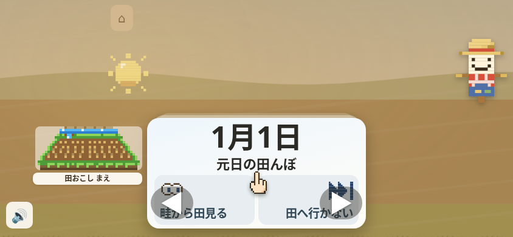
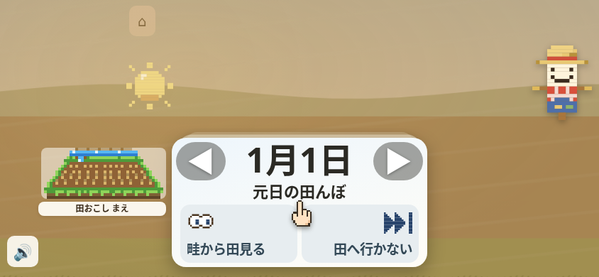

動きを減らす設定の低い横画面で、静止した丸い◀▶が初期の選ぶ文に重なります。`kome365/index.html:799`へCSS1行を追加し、reduce・高さ440px以下・幅564px以上だけtopを33pxへ移します。円70×54px/字40px・選ぶ文・カード・入力を保持します。

同じ844×390・旧新各10回で入力前の文字Range交差は**10/10→0/10**、両矢印の可視と日送りは**10/10→10/10**。6文字Rangeの交差を数えた代理値で、人の理解・離脱率の改善は未測定です。

|旧 case01|新 case01|
|---|---|
|||

|確認|結果|
|---|---|
|`python3 tests/test_kome365_reduce_cue.py -v`|同じ1test：旧exit1(最後の6文字交差assert)→新exit0|
|反復各10 / 5サイズ×2motion各相10|独立監査固定。各runはfavicon404を残しexit1|
|長日付補助fixture|4,464行再計算・矢印対日付/指定8対象の交差0・最小余裕1.078125px・15原PNG実見。exit1/favicon1/warn6|
|`python3 tests/test_kome365_firstmin.py -v`|各106pass/同じ1Finger3D失敗、exit1。HOLD|
|pytest tests/|before/afterとも`pytest: command not found`、exit127/0件。HOLD|

新test v1の座標系誤りは旧REDに数えず、[原失敗とv2の違い](README.md#試験の扱い)を残します。5サイズ画像では新しい不透明な隠れは未確認ですが、320の既存接触と通常指の位相差を保持し、全時点の交差増0とはしません。

再現はfresh844×390/reduceでページの初期診断後約10秒無入力→入力前Range測定→左100px/6moveを120/600ms各5回。製品変更はCSS1行だけで、「運営者の判断」に回した新たな変更案は今回はありません。運営者決定の0.3秒手本・理由2秒/最初3枚・素早い入力・音・太陽/かかし・保護3ファイルを保持します。[GMTK89](https://www.youtube.com/watch?v=4Bv45aPMGyI)の読みやすさを守る原則に対応づけた通常配置の改善候補です。

傾きセンサー・本物の指・実回線の速度・人の理解と離脱率は未確認。原report/case/helpers/全60原PNGはlossless証拠に保持し、[詳報・5サイズ写真・試験・展開手順](README.md)へまとめました。コード＋新test commit `c3598c76…`、静的レビューP0–P3指摘0。必須検証の不成功が残るため、マージ・公開を保留しています。
