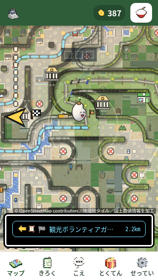
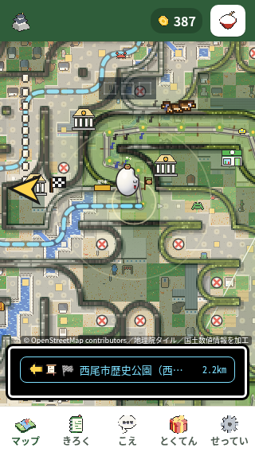

# 第93周・にしおさんぽGO：現在の行き先は場所を先に

現在の行き先が人物名だけで省略される場面に、既存の「場所（人）」の表示順を適用しました。通常プレー・固定10回・5サイズ・テストの実記録をまとめています。**全体unittestと必須Node検査は不合格、pytestは実行環境不足のため、下書きPRでの確認にとどめ、マージを保留します。** 比較元 `2e560433535ff5096a310651ca07bf0725dea395`、検証した製品commit `f4e1ec1d308dccbf861fda4240e32071f7fa8f43`。[数値・画像の出典・手元の根拠SHA](results.json)

## やめそうな所 → 変更

最初の目当てを終えた後、次の行き先が「観光ボランティアガ…」と省略され、場所の「西尾市歴史公園」が読めない場面がありました。どこに向かうかをつかみにくくする候補です。人の離脱率は測っていません。

既存仕様は、1行のまま「場所（人）」の順にして場所を先に見せ、距離も残すものです。現在の行き先が既知のNPCで、既存の人物名・場所名から元の合成名を厳密に再現できる時だけ、その構造で表示順を入れ替えます。元の名前・ID・座標・経路・報酬は変更せず、文字も増やしません。入れ子括弧を一般的に分解する正規表現の拡張や、新しい地名・短縮名の追加はしていません。

表示用情報は返却する一時オブジェクトに非列挙の属性として置きます。既存のJSON保存やspreadによる候補の控え・復元に混ざらず、保存データの形を保ちます。構造がない、元の名前と一致しない、空・不正な値の場合は従来の表示へ戻ります。

場所：`nishio-go/game.js:2363` の現在目標、`:2511` の表示名、`:2531` の描画。テスト：`tests/test_nishio_current_target_name.py:124`。人物名は既存 `nishio-go/npcs.js` の `castle-guide`、場所名は既存 `nishio-go/spots.json` の `nishio-castle` に由来します。

対象は現在目標の主見出しです。保存された元データを使う代替候補・会話の選択肢・通知は従来の文字順が残ります。全ての案内文を直したとは報告しません。

## 確認した数（通常プレーと固定10枠の前後は監査済み）

| 記録 | 修正前 | 修正後 |
|---|---:|---:|
| 通常60秒の入力／反応 | 13／13 | 13／13 |
| 記録上の無反応・console/page/inputエラー | 0・0 | 0・0 |
| 初入力→最初の座標変化の観測上限 | 0.3529秒 | 0.3624秒 |
| 最初の見える正の30pt（プレー時計） | 0.9044秒 | 0.9515秒 |
| 固定10枠の対象表示 | 適格2・地名不可読2・対象未確立8 | 適格3・地名可読3・対象未確立7 |
| 固定10枠の入力／反応 | 135／135 | 138／138 |
| 新規回帰テスト・同じ20ケース | 旧製品で表示2失敗 | 最終製品で20成功 |

通常の60秒原画では、前の「観光ボランティアガ…」に対し、後は「西尾市歴史公園」が先頭に読めました。前後とも距離2.2kmと1行を維持し、長い名前の全体は省略されたままです。各1回の自然プレーであり、固定10回の結論や離脱率の測定には数えません。初入力から30ptの表示観測は804.4→855.5msで、速度改善を主張しません。後の60秒写真は要求60.000→完了60.500秒、直前59.9954秒に同じ案内DOMがありましたが、全画素が60秒内に見えた証明ではありません。30秒写真は案内切替中に0mが写り、安定した前後比較には使いません。

前後の固定10回は40ms・250msを交互に5回ずつ。修正前は40msの01と07が適格で、両方の原画で地名を読めませんでした。修正後は40msの03・05、250msの10が適格で、3枠とも「西尾市歴史公園」を読め、距離も別に表示されていました。前の未確立8枠、後の未確立7枠は非再現や改善に数えません。前後は別の試行で対象への到達状況が異なるため、「2/10→0/10の再現率」や離脱率の改善は言えません。250ms群の修正前には適格対象がなく、指の速さによる原因の有無も未確定です。

対象画像は実行前に固定した順[30秒,60秒]で最初の適格写真を選びました。前01は要求59.999秒〜完了60.694秒、前07は60.000秒〜60.360秒。後03は60.000秒〜60.547秒、後05は30.000秒〜30.681秒、後10は60.001秒〜60.460秒です。後03の30秒写真は案内変更をまたぐため除外しました。60秒境界の写真は、その前後の同じ案内DOMを照合した表示証拠で、全画素が60秒内に見えた証明ではありません。前後それぞれ40原画像を監査者が全て実見し、各10枠は実exit0、ソース照合・CPU解除・ブラウザ終了を確認済みです。後は二次読者のraw再計算とも、全枠の適格性・選択写真・共有数値・初反応・元SHAが一致しました。

固定10回は前135操作／135反応、後138操作／138反応。完全な1100ms観測窓は前133・後134、残りは前2・後4とも反応があり、無反応へ加えません。後はCDP276送信／276応答・414trustedイベント、無反応・console/page/inputエラー・期限後の新規入力・未解放操作0です。初入力から初反応の観測は前0.3430〜0.7245秒、後0.2864〜0.6089秒、初めて見える30ptは前0.7969〜1.3582秒、後0.7001〜1.1024秒でした。別試行のDOM・状態観測であり、この名前変更による速度改善や、実機の描画開始・授与時刻・離脱率は意味しません。

既存の手本→世界地図切替は固定10回で前18回／戻る17回、後12回／戻る12回。情報窓は前後0でした。この既存PR1133の話は別候補として記録し、名前表示の修正による改善とはしません。世界地図への切替も「反応」に数えますが、目的地への有用な進行とは区別します。

## 再現操作と前後画像

リポジトリ直下で `python3 -m http.server 8000` を動かし、ローカルの `/nishio-go.html` をChromiumで開きます。320×568・isMobile・hasTouch・CPU4、最初は10秒見るだけ、その後60秒は見えている手本をCDPの `Input.dispatchTouchEvent` でたどります。固定10回は40ms/250ms交互。新しいcontextごとに開始し、対象のために内部状態や乱数を作り替えません。

Leaflet1.9.4は手元のファイルへrouteで差し替え、他の外部ページ要求もローカル応答または遮断にします。外部サイトへ進めていません。

前後は通常プレーの60秒原PNGです。ともに320×568・CPU4・40ms、同じ長い現在目標・距離2.2km・387ptですが、別々の経路・乱数状態による実行で、同一配置の比較ではありません。固定10回の分母には加えません。前は撮影要求60.001→完了60.255秒、後は60.000→60.500秒で、60秒境界の表示証拠です。全画素が60秒以内に見えたとは主張しません。原画像を実見し、元バイトのままscratchへコピーしてSHAを照合しました。

前：人物名が先頭に残り、場所名が読めません。

後：「西尾市歴史公園」が先頭に読めます。1行と距離を保ち、長い名前の後半は省略されたままです。

元ファイルは `preparation-2e560/play-60s.png` と `after-preparation/play-60s.png`。撮影時刻・ソース・原画SHAは [results.json](results.json) の `photos` に記録しています。

## テストと独立確認

- 最終テストは1メソッド・20 subcase。同じテストSHA `6d982c63…` で、旧製品の表示2失敗（exit1）→最終製品20成功（exit0）を実際に確認しました。実 `guideTarget` と実 `guideDispName` を抽出して既存のNPC・位置補正を模した入力で動かすテストで、ブラウザ上の自然プレーの代わりではありません。
- 一時表示情報が列挙可能だった初期案でも同じ最終テストを実行し、保存・コピーの契約が8ケースで失敗することを確認しました（exit1）。最終製品は非列挙にしてこの問題を解消しています。成功20ケースは1つの成功メソッド内の数で、20個の独立したテストメソッドとは数えません。
- これらの失敗／成功確認はcommit前の実行です。記録された製品SHA `1a0e7253…` とテストSHA `6d982c63…` は検証対象の製品commitに一致します。
- 独立したコードレビューは最終候補で未解決P0〜P3なし。既存305テストと保護された米づくり3ファイルを全て保持しています。検証手順の静的結合も受理されていますが、これらは全体テストや表示の合格を意味しません。
- 検証対象f4eで必須 `pytest tests/` を実際に試行し、exit127。正確なstderrは `bash: line 1: pytest: command not found`。環境不足で実行できていません。
- 最終候補の `python3 -m unittest discover -s tests -v` は実exit1。独立した原ログ監査で2,577メソッド＝2,540成功・35失敗・1エラー・1skip、460.027秒を確認しました。新規1メソッド内20 subcaseは全て成功です。既存 `test_maze_loop4_205.py` は8メソッド中7成功・1失敗で、失敗は新規テストを許可しない `test_scope` です。205件という意味ではありません。
- 35失敗の内訳は変更ファイルallowlist32件（新規testを拒否15、game.jsを拒否14、両方3）、pixel.js公開コードの文字列2件、トラクターの文字列1件。1エラーはトラクターの正規表現検索がNoneのまま `.group()` を呼ぶ `AttributeError`。skipは設計書不在の1件です。現在の基準2e560での比較実行はしておらず、過去と似た失敗でも全て既存の失敗とは断定しません。失敗の免除やテストの弱化はしません。
- 基準の既存305テストと保護された米づくり3ファイルは保持されています。新規1テストを加えた306テスト＋source12件＝318ファイルのSHAとHEAD/tree/refsを、元作業場所・検証用作業場所の記録端点と監査時点で照合しました。private main/origin-mainは比較元2e560のままです。連続した監視ではなく、各記録端点の一致です。
- 必須 `node tools/playtest.js` の全体実行は内側のNodeが実exit1。250群中218明示成功・12明示失敗・20はその群自身の判定なしです。20を成功・失敗・未実行へ読み替えません。原結果のfailure記述12件、収集errors0、全stdout JSONと保存結果JSONは一致しました。失敗群と実行記録の限界は下記に示します。
- 320×568・390×844・568×320・844×390・820×1180は前後各5枠、全10枠が実exit0・ブラウザ終了済み。40原画を監査者が原寸で全て実見し、二次担当のraw再計算と全数値・元SHAを照合しました。二次担当は画像目視をしていないため、目視者2名とは数えません。以下の観測範囲と残件を付けて報告します。

## 必須Node検査の失敗と実行記録

実コマンドは `node tools/playtest.js /workspace/scratch/first-minute/round-93/validation/node-playtest`。既存の全体検査を、手元のLeaflet・Chromium・外部通信差替え用の設定で実行し、`PLAYTEST_ONLY` は指定していません。固定日時・localStorage・位置・直接のゲーム呼出し・混在入力を使う検査なので、自然な最初の60秒のCDP測定や実機の測定とは分けています。

| 失敗した群 | 保存結果の要点 |
|---|---|
| swipeHold | held=true、479ms、g1/g2/g4とg3/wantが異なる、info=false |
| tapDemoQuick | 7件、中央値2580ms・最小2046msで1.7秒条件に不適合 |
| worldBackDemo | 開く・表示・戻る・迷路はtrue、手本3680msで3.5秒条件に不適合 |
| rollNoDemo | rice=262／route=522／demo=522ms、vmax=0 |
| lowGoalDemo | 568×320・ゴール1マス前はshown=false、他3条件はtrue |
| infoSecondTap | 移動true、名所窓open=false、2回のclick対象はpxCanvas |
| infoRotate | 390×844の窓は初めからopen=false。820×1180の窓・回転後closeOk・閉じた結果はtrue |
| lowDemoKept | ready/walked=true、最初はon=false、後はon=true・inMap=true |
| restFinger | tap/swipe/pinch=false、touchAction=pinch-zoom、info=false |
| tiltDemoShown | on/phone=false、force=0.28、moved=0.9。実センサー測定ではない |
| godotRec | errs=[]、len=5924、shade=0 |
| speedLines | room=7、fast=0、vmax=4.16、far=0.96 |

原failure文に複数条件が並ぶ場合も、全ての原因が起きたとは扱いません。例えばinfoRotateは、全ボタンが画面外に出たという証拠ではありません。`firstDemoFast`・`firstTapBig`・`firstTapFit6`・`demoTouchWait`・`wrapWords320`・`infoCloseSmall`などは各群自身のok=trueでしたが、必須検査全体の不合格を免除しません。現在の基準2e560での全Node比較実行はなく、過去の似た失敗を理由に既存の失敗や今回の回帰数と断定しません。

内側のNodeは2026-11-13 23:06:47.483574〜23:34:46.814356 UTCに実行し、終了1を保存しました。外側のPython実行記録は終了120で、内側1との不一致が残っています。環境の接続が失われた後も元の実行は完了し、再接続後に保存済みの最終記録を読みました。切断・再接続が120の原因だとは確立していません。**P1：必須検査不合格、P2：内外の終了コード不一致**として残します。Nodeの通常終了経路にclose呼出しはありますが、別のlifecycle観測や全プロセス・全ポートの終了確認はこの監査では行っていません。

sourceと検証用cloneの各318ファイルSHA、HEAD/tree/clean/refs、基準の旧305テスト、新規1テスト、保護3ファイル、private main/origin-mainの基準、外部通信差替え用ファイルは準備・開始・終了・監査の端点で一致しました。独立した再計算も全250群の名前・分類とソース保全に一致しています。318ファイルは選定した範囲で、全アセット・全依存関係の総目録ではありません。

公開前に読んだmainは `4568c8792f4c804cf354f6f63a12ef568e2b6748`。基準2e560からの差分は検査ゲーム・トラクター関連5ファイルで、`nishio-go/game.js` は変わっていませんでした。候補へは取り込んでおらず、この報告のテストはf4e／基準2e560に対する結果です。最新mainを取り込んだ統合検証ではありません。

## 5サイズで見た範囲と残件

前94入力／60秒内94反応、後104入力／103反応でした。完全な1100ms窓は前93・後100、不完全窓は前1・後4で、後1件は反応未確立です。後844×390の最後のA36は59.871秒に押し、59.911秒に離し、trustedイベントと世界地図の反応は60秒を過ぎて記録されました。期限内の反応数へ加えず、完全窓での無反応とも数えません。完全窓の無反応・console/page/inputエラーは前後0、CDP応答／送信は188／188→208／208、trustedイベントは282→312です。

保存された40原画では、新しい案内文字の重なり・画面外への切れを確認しませんでした。指定した可視要素のviewport外矩形は前後0ですが、document全体のscrollWidthと全controlのrect・全領域hitは未測定です。20写真ペア中、world/info状態が両側で安定・一致するのは18、案内文字も安定・一致するのは13で、位置・乱数・描画時刻まで一致する比較ではありません。全状態で重なり・はみ出し・押せない所の増加なしとは主張しません。

情報背景と案内の交差は60秒内のsampleで18→61あり、ゼロではありません。これは情報背景がゲーム領域を覆う状態で、前後820×1180の30秒原画ではdialog本体と閉じる文字は画面内にあり、下の案内から離れています。世界地図の戻る中心hitは209／209→244／244、情報の閉じる中心hitは18／18→61／61が内側でした。中心1点のhitで全領域の押しやすさは保証しません。

この5サイズで長い現在目標が適格だったのは、前820×1180の60秒と後390×844の60秒が各1枚だけで、両方とも場所名が読めました。その他の各4枠は対象未確立です。同じサイズ・同じ対象の直接ペアではないため、5サイズの改善率として使いません。最初の入力から初反応は前0.298〜0.560秒・後0.385〜0.559秒、可視30点は前0.679〜1.232秒・後0.732〜1.138秒の観測値で、速度改善も主張しません。

**P2・別候補**：手本入力が世界地図を開く挙動は前16回／戻る16回→後17回／戻る17回、情報画面は前3回／閉じる3回→後10回／閉じる10回。後820×1180の30秒・60秒は215点のままでした。反応があっても目的地への進行とは数えません。世界地図は既存PR1133の分類、情報画面は別の残候補です。名称修正との因果は未確立で、今回の修正へ混ぜません。関連経路は `nishio-go/pixel.js:9571` の `tapDemoWalks`、`:9656` の `tapDemoSpot`、`:9721` の `tapDemoTick` です。

前のバッチ中に道具のsession参照が失われましたが、元wrapperはそのまま継続し実exit0を保存しました。再試行はなく、道具の接続喪失をゲーム失敗として数えていません。

[ricepia-flowの規則](https://github.com/shota0617/ricepia-judge/blob/2e560433535ff5096a310651ca07bf0725dea395/.claude/skills/ricepia-flow/SKILL.md#L212)の「テストが 落ちている」変更は「マージせずに 伝える」に従い、全体テストに失敗がある間はマージを保留します。

## 運営者判断と未確認のこと

1行を2行にする、常時説明を増やす、名前を短く言い換える、次の目標や区切りを作り替える案は運営者判断として残します。今回の変更は既存の「場所（人）」の仕様を、検証できる現在目標に適用する範囲です。

最初の本当のclickでの傾き許可、許可前・停止中の手本、開始画面なし、到達カードなし、1行の名前と距離は維持します。実機のセンサー・本物の指・実際の回線・描画性能、人の理解や最初の1分の離脱率は未確認です。

この記録に集約結果と選んだ前後原画像を添付しています。手元の全原ログ・全原画を公開したものではなく、resultsのSHAは元証拠との照合用です。製品の検証commitと、この記録を追加する公開commitは区別します。
