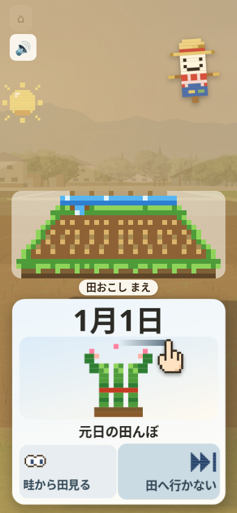
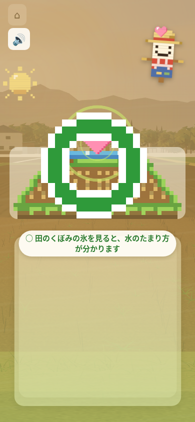
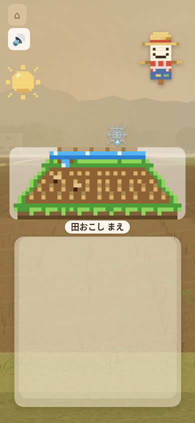
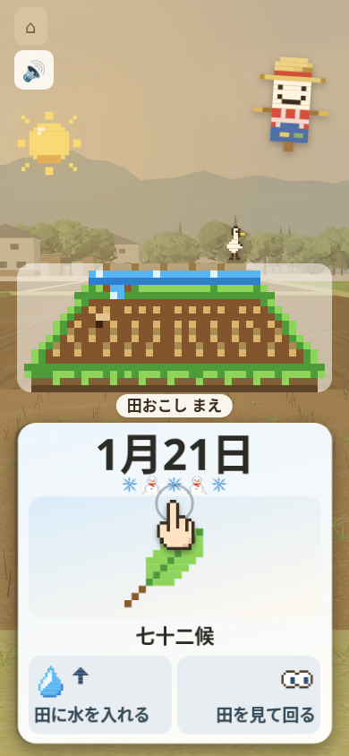

# 第94周 米づくり365：最初の1分の観察記録

今回、最小修正へ採用できる不具合は確定しなかったため、ゲーム・テストは変更していません。通常プレー20手はすべて日付の進行につながりました。中断後に手本が戻らない候補は、作業場のChromiumで実際の背景化が成立せず、未確認です。不再現・修正成功には数えません。

対象は main `4568c8792f4c804cf354f6f63a12ef568e2b6748`。リポジトリ最上部で `python3 -m http.server 8000` を起動し、`http://localhost:8000/kome365/index.html` をPlaywrightのChromiumで開きました。390×844、isMobile/hasTouch、CPU1、空の保存で10秒観察後、画面の左右の手本に沿って60秒操作しました。CDP `Input.dispatchTouchEvent`、要求120msの左右交互、右から開始、操作後待機2200msです。既存vendorのThree r128を使い、外部要求を遮断しました。終了時の実3Dと音ON、CPU復帰、ブラウザ終了、製品5ファイルとHEADの不変を確認しています。

| 見たもの | 今回の結果 |
|---|---|
| 操作→反応・進行 | 20入力／20反応／20日付進行。完全観測窓の無反応0。160 CDP命令すべてACK、trusted pointer 60件 |
| 最初の手ごたえ | 初手送信→カードtransformのDOM変化670.5ms、翌日と理由1076.4ms |
| 最初の肯定的結果 | 最初3手は✗、4手目で○。プレー開始約9.9998秒、初手送信から9.7488秒、4手目送信から1.1008秒。全体7○／13✗ |
| 60秒の進み | 1月1日→21日。「田おこし まえ」が見える。短い達成目標や次の作業への距離は、この原画では確認できない |
| エラー・終了 | 実exit1。consoleのfavicon.ico 404が2件、pageerror0。エラーを除外して合格にはしていない |

DOM・CDPの時刻は物理描画や人の理解の時刻ではありません。観察10秒の写真保存に6.7956秒かかり、操作開始は観察開始16.8949秒後です。この測定側の待ちは製品の待ち時間と分けます。別の乱数・画面条件の過去周から速度や離脱率の改善は主張しません。

原画は `observe-10s.png`、`play-10s.png`、`play-30s.png`、`play-60s.png`。全4枚を原寸で実見しました。10秒・30秒の原画には切替中のカードが写らない瞬間がありますが、日付進行とfly/enterの記録があり、空白の持続時間・操作不能・永久停止は未確立です。写真は要求から保存完了までの区間を持ち、60秒写真の要求は60.002秒、完了は約60.676秒。厳密な60秒内の全画素の証明ではありません。製品変更がないため、修正前後の比較画像はありません。

中断候補の単一診断は、最初のカードを20pxだけゆっくり引いて保持→別のabout:blankタブを前面へ→元のゲームのCDPへtouchEnd→ゲームへ戻り3秒観察、という手順です。4待機合計700msにCDP応答待ちが加わるため、実際の指の速さは送信時刻で区別します。指は実際に配送されましたが、ゲームの `document.hidden` と実visibilitychange(hidden)が成立しませんでした。背景化・隠れた間の指離し・実際の可視復帰の3条件が未成立で実exit2。最後のカードと手本が戻ったことは、背景からの復帰の成功証明にはしません。改変してhiddenを作る操作や、イベントを抜いて作る再現はしていません。10回再現・速度別比較・修正後測定には進んでいません。原因候補の場所は `kome365/index.html:3175,3991,4017,4033,4062`。

運営者の判断へ回す候補は、最初の正誤と手本の初方向、理由が次の日のカードの上に出る点、短期目標・次の作業の見え方、かかしに置いた指と別の指のスワイプの扱いです。最後の候補は未実行で、既存のかかし指保護と `tests/test_kome365_firstmin.py:625` の規則との整合が未確立です。0.3秒の手本、素早いスワイプ、タップで選ばないこと、端のかげ、理由の位置と2秒、30秒カード、音、かかし・太陽は変えていません。`engine.js`・`field3d.js`・`cards.js`も不変です。

`pytest tests/` は実exit127、エラー原文は `bash: line 1: pytest: command not found`。成功したテスト数はありません。製品の修正がないため新規回帰テストと旧版RED／新版GREENはありません。既存テストは削除・変更・停止していません。5サイズの追加プレー・修正前後比較は今回未実行で、全サイズの押しやすさを保証しません。

画面の農作業の文は既存 `kome365/cards.js`、表示と入力は `kome365/index.html` が出典です。新しい農作業の事実・素材・音は足していません。実機の傾きセンサー・本物の指・通知やアプリ切替・回線速度・人の理解と離脱率は未確認です。

`results.json` に集計、実コマンド、SHA、写真撮影区間と未確認の範囲を保存しています。全rawファイルを公開したものではありません。必須テストを実行できていないため、[ricepia-flow](https://github.com/shota0617/ricepia-judge/blob/4568c8792f4c804cf354f6f63a12ef568e2b6748/.claude/skills/ricepia-flow/SKILL.md#L212)の「テストが 落ちている」→「マージせずに 伝える」に従い、下書きでマージ・本番公開を保留します。
