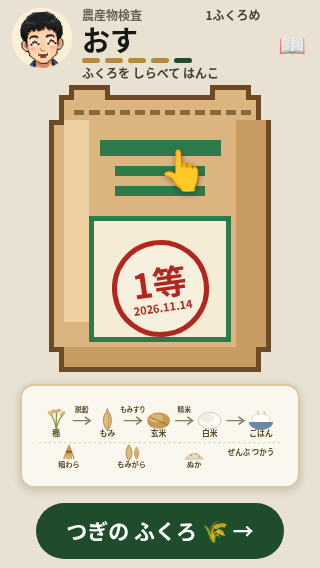
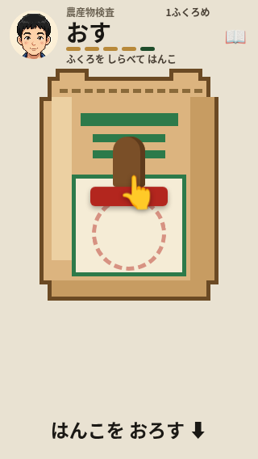

# 第96周：検査ゲームのはんこ操作を別の指で失わない

最初の袋ではんこを動かしている途中に、袋を支える別の指が触れると、下ろし始めの位置が書き換わり、元の指を手本の終点まで動かしても印が付きませんでした。最初の袋の達成直前で操作が途切れる問題を対象にしています。

前後の独立監査で、押印できない試行が **10/10→0/10**、単指対照は **2/2→2/2で押印**しました。ただし、**全体テストは不合格のためマージ・公開保留**です。これは実プレイヤーの離脱率を測った結果ではありません。

実装と新テストの対象commitは `031bf9a`（資料追加前）。完全な識別子、同じテストを使ったRED/GREEN、検証履歴は[results.json](results.json)に保存しています。

## 変更

`kensa.html` に21行を追加しました。既に動かした指の接触IDを保ち、別指のdown/move/up/cancelで基準位置や所作を失わないようにしています。captureが失われた場合は取り消して新しい指を受け付けます。袋がまだ指を追えているpointerleaveと、子要素から伝わったcapture喪失では取り消しません。

場所は `kensa.html:2436`・`:2454`（開始・移動）、`:2484`（作業中の指の判定）、`:2494`・`:2502`（取消し・終了）、`:2541`（追跡喪失後の回復）。新規テストは `tests/test_kensa_hanko_pointer_ownership.py:160` です。

静止中の持ち替え、朱肉18px／250msから同じ指で下ろす動き、押印距離・空振り回数・手本・音を保ちます。既存305テストファイルと `kome365/engine.js`・`field3d.js`・`cards.js` は変更していません。

## 再現条件と前後

1. リポジトリ直下で `python3 -m http.server 8000` を動かし、作業場のChromiumで `/kensa.html` を開く。外部要求は遮断。検査ゲームに外部部品の差替えは不要。
2. 320×568、isMobile・hasTouch、CPU追加減速なしの指定値1。10秒観察後、CDP `Input.dispatchTouchEvent` の指で表示手本に従う。
3. 最初の袋で朱肉を付け、P1を手本の始点から下へ10px動かす。実際のはんこの移動をDOMで確認する。
4. P1を保持したまま袋の右下へP2を置く。P2静止のままP1で残りの手本を下ろし、両指を離す。対照はP2追加だけを省く。
5. 真のpointer ID・対象・終点、取消し、印と次ボタン、60秒期限、指の解放を記録する。失敗・不適格を再試行せず、固定枠から除かない。

| 条件 | 修正前 | 修正後の実行記録 |
|---|---:|---:|
| 単指対照・40ms／700ms各1 | 押印2/2、未確立0 | 押印2/2、未確立0 |
| P2追加・40ms各5 | 印なし5/5 | 押印5/5、印なし0/5 |
| P2追加・700ms各5 | 印なし5/5 | 押印5/5、印なし0/5 |
| 本試行合計 | 印なし10/10、未確立0 | 押印10/10、印なし0/10、未確立0 |

前後とも各枠はfresh process/context、全枠の実終了0。修正後12枠の独立監査でも適格条件・終了後の安全確認・18pinsの前後一致が成立し、1690送信すべてにACKがありました。前後の判定基準・P1 prefix150ms/3段階・残り9段階・DOM読取り・60秒時計は同じです。

150/40/700msは待機合計です。実時間にはCDPのACK待ちとDOM読取りも入ります。修正前の本試行でdown送信→release ACKは40ms指定420〜431ms、700ms指定973〜1024msでした。速さを変えても発生しましたが、本物の指の速さと同じだとは言えません。診断後は台本が入力を止めるため、30/60秒でも印がないことから永久に操作不能とは判断しません。

修正前独立監査の厳密時刻チェックは379/382件。3枠の観察写真要求が9999msでしたが、写真完了と初入力は10秒後でした。固定19適格条件と分母は変更していません。この3件を全成功と読み替えていません。修正後も393/394件で、固定枠03の観察写真要求9999msを1件falseのまま保存しています。写真完了10069ms、初入力10082msで、分母や適格条件は変更していません。

修正後もP1の最初の10pxに手ごたえがあり、P2追加後のP1移動でも下ろし続け、全10回で押印しました。次の表は最初のP1送信からの値で、**指を動かしている時間を含みます**。応答だけの遅延や正確な描画開始ではありません。

| 残り待機条件 | 押印classの最初の記録 | 次袋ボタンのCSS可視を確認した保存DOM上限 |
|---|---:|---:|
| 40ms・5枠 | 354.1〜358.6ms | 441〜444ms |
| 700ms・5枠 | 654.1〜683.2ms | 977〜1003ms |

印そのもののCSS可視を確認した保存DOM上限は40ms条件441〜1111ms、700ms条件977〜1003msです。classが付いた時刻と、CSSで見えると確認した時刻は区別しています。

## 最初の1分

**以下は最初の10秒の無操作観察を終えてからの遊び時間です。** 写真のplay-10s/30s/60sもこの時計で、ページを開いてからの時刻ではありません。

| 修正前の通常primary | 記録 |
|---|---|
| 最初の返り | 最初の案内変化の標本まで約0.225秒。操作後pollでは0.418秒以内 |
| 最初の肯定的な結果 | 「ちょうどいい」の標本3.104秒。人が報酬と感じた時刻は未測定 |
| 最初の袋の完了 | 次ボタンのDOM読取り15.294〜15.297秒、2袋目の見出し16.304秒 |
| 60秒まで | 36操作に36反応、反応記録なし0、page/console/driver error各0。46.504秒に3袋目 |

通常primaryのはんこは単指です。36反応を、2指の問題が起きなかった36試行や36工程の進行とは数えません。標本・pollの時刻は物理画面の表示開始や人の理解時刻ではありません。

## 原画像

以下8枚は保存原本のバイトをそのままコピーしたPNGです。加工・切抜き・再撮影はしていません。前後の比較画像は同じ固定枠の操作後で、1回の未修正診断内の「操作前／操作後」ではありません。独立監査では前72枚・後72枚の原画像が実見され、診断後10枚すべてで前は点線の空円、後は完成印・工程の絵・次の袋ボタンが確認されています。

| 通常primaryの段階 | 原画像 |
|---|---|
| 無操作10秒の観察終了 | [observe-10s](images/primary-observe-10s.png) |
| 遊び10秒 | [play-10s](images/primary-play-10s.png) |
| 遊び30秒 | [play-30s](images/primary-play-30s.png) |
| 遊び60秒 | [play-60s](images/primary-play-60s.png) |

| 残り待機合計 | 修正前・印なし | 修正後・押印 |
|---|---|---|
| 40ms・固定枠01 |  |  |
| 700ms・固定枠02 |  |  |

## テストと画面の確認

- 最終の同じ新規テストを旧HTMLへ向けると36 subcases中17失敗、実終了1。修正HTMLでは36/36成功、実終了0。1 test methodの36 subcasesで、抽出・fixtureエラーを行動REDとして数えていません。
- `python3 -m unittest discover -s tests -v` の最終実行は **2578件＝2508 OK・68 FAIL・1 ERROR・1 SKIP、446.979秒、実終了1**。検査ゲームの既存192件と新規1 method／36 subcasesは成功しました。全体は不合格です。
- 残る失敗は変更範囲のallowlist 65 FAIL、pixel公開文字列2 FAIL、tractor読み込み文字列1 FAIL、tractor regex 1 ERROR。同条件の基準版全体テストとの比較はなく、既存失敗として免除していません。
- `pytest tests/` は実終了127、`bash: line 1: pytest: command not found`。unittest結果をpytest成功へ読み替えません。参照修復とローカルブラウザ設定による再実行履歴はJSONへ残しています。
- 320×568・390×844・568×320・844×390・820×1180の前後5枠ずつを独立監査済み。各側175操作に175反応、2450送信すべてACK、error 0。原画像は前後各20枚を実見し、保存layoutは各525件です。

横documentはみ出しは0/525→0/525、画面に一部があるcontrolの矩形はみ出しは0/1708→0/1705でした。中央hitで有効な資料リンクを皿が受ける記録は合計4→4ですが、**568×320は2/105→0/105、844×390は2/105→4/105**です。「みわける」に限る各分母は48です。後844の4件は27.606/27.616秒と32.189/32.201秒のズーム遷移中で、30秒写真は同じ瞬間ではありません。写真にないことを改善と数えません。

比較できた115の部品・場面群で、新しく遮蔽を観測した群は0。片側だけの12群はinert旧場面で比較不能です。ズームの途中経過と観測時刻が異なるため、844の増加の原因は未確定で、**全画面で重なり・押せない所の増加がないとは断定しません**。この既存ズーム候補を今回のはんこ修正へ混ぜず、10回再現や修正済みとも扱いません。中央hitは全押下領域を保証せず、固定4組の親矩形も変形した皿を含みません。全サイズで通常のはんこ操作へ2回ずつ到達しましたが、固定時刻の写真には押印場面が写っていないため、根拠はDOM・入力・反応記録です。

## 運営者の判断と限界

最初の1回のタップ、つまむ／きめるの自動進行、45秒カード、見せるだけの遊びの形は変更していません。PR #1144に関係する顔と案内の既知候補も別に残します。

本物の指、傾きセンサー、回線速度、音の聞こえ方は未確認です。ホスト速度は校正しておらず、実プレイヤーの離脱率・保持率の改善は主張しません。検査の事実・名前・画像・音は追加していません。

マージ・公開保留の理由は、全体テストの不合格です。[ricepia-flowの公開条件](https://github.com/shota0617/ricepia-judge/blob/4568c8792f4c804cf354f6f63a12ef568e2b6748/.claude/skills/ricepia-flow/SKILL.md#L212)に「Codex の 指摘が のこっている・テストが 落ちている・運営者の 判断が いる 変更は、マージせずに 伝える」とあるためです。5画面の比較結果にも上記の限界を残しています。
