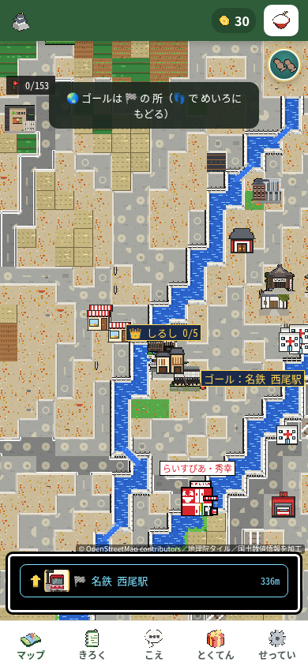
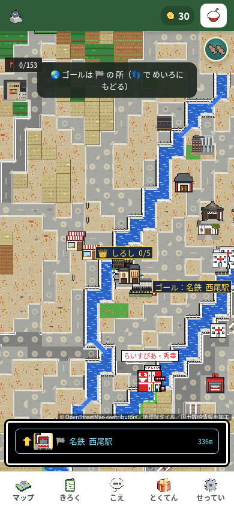
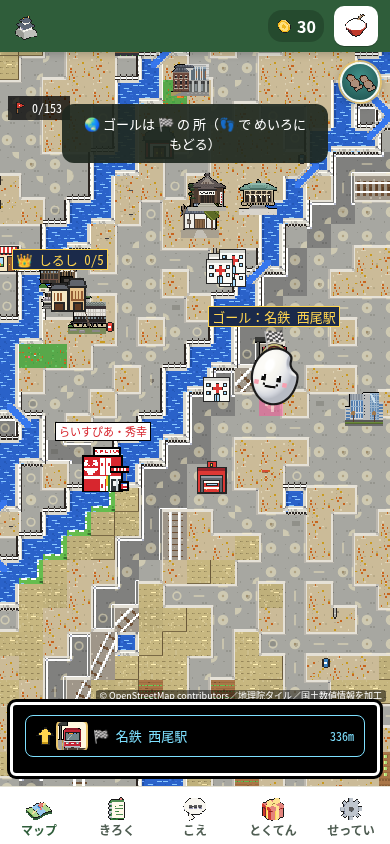

# 第97周・にしおさんぽGO：2本目の指で地図が飛ぶ問題

最初の1分に行先を確かめる全体地図で、動かしている指とは別の指が触れると、地図が大きく飛んで目標を見失う。操作中の指の記録を保ち、同じ固定操作での飛びを **10/10回 → 0/10回** にした。実プレイヤーの離脱率は未測定。必須検査に不合格が残るため、下書きPRとし、マージ・本番公開は保留する。

数値、対象コード、掲載写真の出典・時刻・SHAは [results.json](results.json) に収録した。そこにある作業場の原ログ識別子は公開リンクではなく、原本の保管場所とSHAを示す。

## 修正と再現

製品変更は [pixel.js:9292](https://github.com/shota0617/ricepia-judge/blob/eceaff9f60d872049b49f033857ec4e26cfb63e2/nishio-go/pixel.js#L9292) の指のIDと終了処理。ドラッグ中に別の指の押下・移動・終了で基準を取り替えない。ドラッグ開始前の持ち替えは残し、中断・キャプチャ喪失・非表示・モード切替では古い記録を終える。[押下と移動](https://github.com/shota0617/ricepia-judge/blob/eceaff9f60d872049b49f033857ec4e26cfb63e2/nishio-go/pixel.js#L9297)、[終了イベント](https://github.com/shota0617/ricepia-judge/blob/eceaff9f60d872049b49f033857ec4e26cfb63e2/nishio-go/pixel.js#L9311)、[地図切替](https://github.com/shota0617/ricepia-judge/blob/eceaff9f60d872049b49f033857ec4e26cfb63e2/nishio-go/pixel.js#L9253)、[ゲーム切替](https://github.com/shota0617/ricepia-judge/blob/eceaff9f60d872049b49f033857ec4e26cfb63e2/nishio-go/pixel.js#L9358)も確認した。旧版の基準上書きは [pixel.js:9290](https://github.com/shota0617/ricepia-judge/blob/4568c8792f4c804cf354f6f63a12ef568e2b6748/nishio-go/pixel.js#L9290)。

再現条件は390×844、CPU等倍、`isMobile: true`・`hasTouch: true`、新しい保存状態のChromium。リポジトリ最上位で `python3 -m http.server 8000` を起動し、`http://localhost:8000/nishio-go.html` を開いた。Leaflet 1.9.4は手元の部品へ差し替え、その他の外部page要求を空の応答で遮断した。操作はCDPの `Input.dispatchTouchEvent`。

1. 10秒観察した後、表示手本を1回押し、描画された行先矢印を1回押して全体地図へ入る。
2. 1本目をキャンバス中央より左30pxの位置に置き、右40pxを10pxずつ4回で動かす。待機指定は合計200ms。
3. 1本目を離さず、2本目をキャンバス左端から15%・上端から28%の位置に添えて静止させる。境界の観察・撮影を行い、1本目をさらに右40px動かす。後半の待機合計40ms／700msを交互に各5回。最後に両指を離す。
4. 同じ手順から2本目だけを除いた1本指対照も、各速度1回ずつ行う。各枠は別のprocess/contextで、60秒までの記録と10・30・60秒の写真を残す。

地図の読込み状態`ok`、同じ目標、実trusted touch、全応答・解除・時刻を確認した。目標の描画が期待する右40pxから横8px超、または上下8px超ずれることを候補とし、原画の方向・大きさも別に確認して数を確定した。

| 条件 | 修正前の飛び | 修正後の飛び |
| --- | ---: | ---: |
| 2本指・40ms指定 | 5/5 | 0/5 |
| 2本指・700ms指定 | 5/5 | 0/5 |
| 2本指・計 | **10/10** | **0/10** |
| 1本指対照 | 0/2 | 0/2 |
| 未成立・再試行 | 0・0 | 0・0 |

指の継続移動は全件右40・上下0 CSSpx。2本指での目標描画は**右187・下162 → 右40・上下0**となり、対照は前後とも右40・上下0だった。前後各120原PNG、各178/178 CDP応答を独立確認。記録上のconsole・入力・撮影・解除エラーは0、全枠でブラウザ終了とCPU設定復元を確認した。

40ms指定の実継続時間は前129〜169ms／後131〜138ms、700ms指定は前721〜735ms／後719〜740ms。CDP応答等を含む実経過で、本物の指の速度や性能改善率ではない。先行診断の「2本目だけ離す」は実pointerupが出ず手順全体が不成立だったため、固定10回に含めていない。

固定再現の修正後12枠は `4c7ce72c` で実施した。その後、1ケースの途中状態を確認するテストだけを補強した `eceaff9f` で、後5画面と全体検証を実施した。固定再現12枠を後のコミットで再実行したものではない。両コミットの製品SHAは同一の`f56a976d…`である。

## 前後の原画像

同じチェックポイントの別の試行で、原PNGは無加工。厳密な移動量は原記録、写真は方向と大きさの照合に使った。同一の壁時計・乱数状態の比較ではない。

| 条件 | 修正前 | 修正後 |
| --- | --- | --- |
| 40ms指定 |  |  |
| 700ms指定 |  |  |

修正前（`4568c879`）の通常プレイの原写真：[観察10秒](primary-observe-10s.png)・[プレイ10秒](primary-play-10s.png)・[30秒](primary-play-30s.png)・[60秒](primary-play-60s.png)。この通常プレイでは8/8操作に反応し、無反応0、最初の反応は入力から97.9ms、最初の30pt表示はプレイ0.337秒・入力から329ms。最初の`goals=1`の採取は約19.47秒だった。世界地図を意図的に開く固定診断とは別測定である。

60秒写真の保存完了は通常プレイ60.130秒、固定再現は前60.071〜60.104秒／後60.079〜60.122秒。入力期限と撮影完了を分け、60秒内に全画素を保存したとは扱わない。

## 検証結果

検証対象は製品と最終テストを含む `eceaff9f`。この公開資料のコミットは検証後に追加するため、その後のHEAD全体で検査を再実行したものではない。製品・テストのバイト同一性と、Git差分ファイル名も見る全体検査の対象HEADを区別する。

| 実行した検査 | 結果 |
| --- | --- |
| [新テスト](https://github.com/shota0617/ricepia-judge/blob/eceaff9f60d872049b49f033857ec4e26cfb63e2/tests/test_nishio_world_drag_owner.py#L307)を旧製品で実行 | 同一の最終テストで1メソッド・33小ケース中20失敗／13成功、実exit1 |
| 同じテストを修正製品・最終候補で実行 | 1メソッド・33小ケースすべて成功、実exit0 |
| `pytest tests/` | 実child/outerとも127。`bash: line 1: pytest: command not found` |
| `python3 -m unittest discover -s tests -v` | 2,578メソッド：2,553成功、22失敗、2エラー、1スキップ。451.327秒、実child/outerとも1 |
| `node tools/playtest.js` | 250群：明示成功221、失敗9、独立した真偽判定なし20。実child1、outer終了値は接続断で取得不可 |

新テストの33小ケースを33メソッドとして加算しない。旧／新製品コピーへ同じ最終テストを置いて実際にRED/GREENを確認し、最終候補でも再確認した。既存305テストは削除・緩和・停止していない。

全unittestの22失敗は変更ファイルの制約19件・公開項目の文字列検査2件・トラクター表示検査1件。2エラーはトラクターの正規表現不一致と、`git diff main...HEAD -- nishio-go/pixel.js` の128（`fatal: bad revision 'main...HEAD'`）。スキップは設計書不足。同条件の基準版を実行していないため、全失敗を既存として免除しない。

Nodeの9失敗は`swipeHold`・`tapDemoQuick`・`rollNoDemo`・`lowGoalDemo`・`infoSecondTap`・`restFinger`・`tiltDemoShown`・`godotRec`・`speedLines`。ブラウザの記録エラー配列は空だが、検査全体は不合格。元のwrapper集計178/9/63は`.ok`プロパティだけを数えたものなので、その63に含まれる直接の`true`43件を独立集計では成功へ分けた。残る20件は複合条件への入力17件・補助記録3件で、成功や未実行とは一括して扱わない。

Nodeは同じ処理を継続し、再試行0。待機接続だけが失われたため、実child終了値1やwrapper予定値1からouterの値を推測していない。完了後に元の3プロセス消失と、別PGIDも含むNode/Chromium残存0を確認した。最終候補で実施したpytest・追加unit・全unittest・Nodeの4検査では、各検査で対象320ファイル・依存548ファイル・RED/GREEN原証拠4ファイルを保持した。

## 5画面と残した候補

| 画面 | 修正前の操作／反応 | 修正後の操作／反応 |
| --- | ---: | ---: |
| 320×568 | 16/16 | 12/12 |
| 390×844 | 8/8 | 8/8 |
| 568×320 | 20/20 | 20/20 |
| 844×390 | 31/31 | 23/23 |
| 820×1180 | 23/23 | 26/26 |

後は計89/89に記録反応（87完全窓、末尾の短い窓内で反応2）、178応答・trustedイベント267・エラー0、5枠すべて実終了0。原20枚と8,227保存記録・69,179矩形の共通観測範囲で、新たな重なり・横はみ出し・画面外は見つからなかった。全状態や全ボタンの押しやすさを保証するものではない。

844×390の情報カード末尾2ボタンの中央が「とじる」に隠れる状態は、**前後で同じ矩形・hitのまま残った**。前296件（2×148）→後56件（2×28）はカード表示5回→1回の違いで、改善ではない。後の定時写真にカードはなく、途中の矩形・中央hitの記録による判断。スクロール後や2ボタンの実押下は未確認。別候補として残す。場所は`nishio-go/style.css:421,431,953`と`nishio-go/game.js:517,518`。

探索は入力記録・原画像・コードの3通りで行い、固定再現に至ったのは指の記録の調査だった。距離の増減の伝え方は「運営者の判断」、長い次の目標までの途中の進歩表示は別の大きい設計案として残し、今回の修正へ混ぜていない。

最初の本当のclickでの傾き許可、最初と停止中の手本、開始・到着カードを置かないこと、矢印から全体地図へ入る操作を維持する。保護3ファイル・外部サービス設定・新しい地理の事実や借用素材への変更はない。実機の傾きセンサー・本物の指・回線速度・音・物理描画時刻は未確認。

必須検査が不合格のため、[ricepia-flow SKILL.md:212](https://github.com/shota0617/ricepia-judge/blob/4568c8792f4c804cf354f6f63a12ef568e2b6748/.claude/skills/ricepia-flow/SKILL.md#L212)の「Codex の 指摘が のこっている・テストが 落ちている・運営者の 判断が いる 変更は、マージせずに 伝える」に従い、下書きで報告しマージ・本番公開を保留する。
