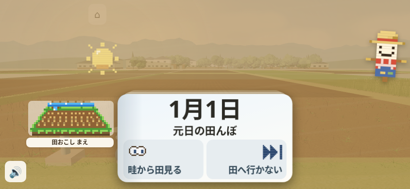
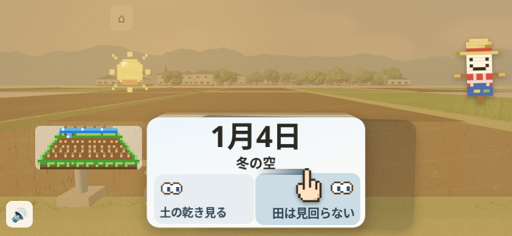
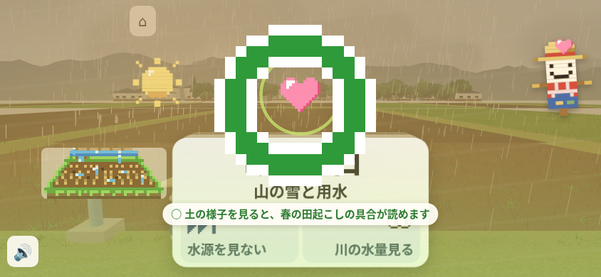
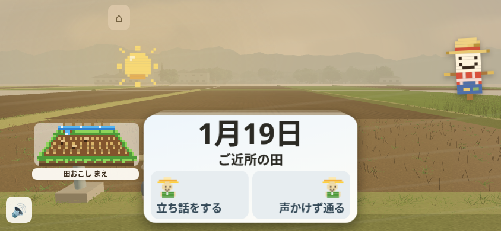

# 第98周・米づくり365：横画面の最初の1分

844×390の通常スワイプは**18/18回で反応し、翌日へ進んだ**。今回の実測から最小修正へ採用できる新しい不具合は確定しなかったため、製品・テストは変更していない。次の左右選択は見える一方、近い目当ての伝え方は「運営者の判断」として残す。実プレイヤーの最初の1分の離脱率は未測定。

対象製品は `4568c8792f4c804cf354f6f63a12ef568e2b6748`。公開資料のコミットは観察後であり、資料追加後のHEAD全体を検証したものではない。[results.json](results.json) に18操作の時刻・判定・原証拠SHAを収録した。作業場の原ログ識別子は公開リンクではなく、原本の保存場所を示す。

## 遊んだ条件と結果

リポジトリ最上位で `python3 -m http.server 8000` を起動し、`http://localhost:8000/kome365/index.html` をChromiumで開いた。844×390、CPU1、`isMobile`・`hasTouch`、空の保存状態。手元のvendor Three r128を使い、外部要求を遮断した。10秒見るだけで観察し、写真保存後に60秒のプレーを開始した。CDP `Input.dispatchTouchEvent` で見える左右の選択を右から交互に、要求120ms・100px・6 move、操作後2200ms待ちで選んだ。

| 観測 | 実結果 |
| --- | --- |
| 操作→反応・進行 | 18入力／18反応／18日付進行／18理由。観測窓内の無反応0 |
| 実入力 | 144/144 CDP応答。trusted pointer54件（down・move・up各18）。入力skip・期限後cleanup0 |
| 最初の反応 | 入力→dragのDOM変化0.9153秒、transform1.0437秒、翌日と理由1.5549秒 |
| 最初の肯定的な結果 | 4手目、プレー11.5109秒・当該入力から1.3029秒に○の理由を記録。初3手は✗、全体9○／9✗ |
| 1分の進み | 1月1日→19日。最後の入力55.624秒、翌日への進行56.9833秒 |
| 実行の終了 | 実child/outerとも1。consoleのfavicon.ico 404が2件、pageerror・driver error0 |

各手は送信から次の送信まで、最後は60秒締切までを観測窓とし、全18手で反応・進行を確認した。CDPのmove108命令と実pointermove18イベントは別の数である。固定の左右列なので、新人が必ず3回失敗する・初○まで必ず11.5秒かかるとは言えない。○は正の判定の代理指標で、人がごほうびと感じた秒ではない。

初手のpointerdownはeventTimeStamp→受動capture処理に約905.9ms、その処理→dragのDOM変化に約9.5msだった。配送前の待ちを`cardDown`内の処理だけへ帰属しない。DOM・CDPの秒は物理描画や本物の指の応答時間ではない。全18手の入力→transformは0.6170〜1.0437秒で、速さを変えた対照は未実施。

観察写真の保存には5.2268秒かかり、観察開始→プレー開始は15.40885秒。この測定側の待ちを製品の応答遅延へ足さず、実際の経過も10秒へ書き換えない。CPU復帰・ブラウザ終了・製品ソース不変・終了後のNode/ブラウザ残存0を記録で確認した。404のプレーへの影響は未確立だが、実行を合格扱いにはしない。

## 原写真

4枚は無加工の原PNG。rootと視覚・設計の担当が実見し、DOMの近傍時刻と照合した。写真の要求→保存完了は観察10.001→15.228秒、プレー10.005→10.814秒、30.001→30.636秒、60.001→61.105秒。全区間で同じ画素が続いた、正確な指定秒の画素を保存した、という意味ではない。

| 観察10秒 | プレー10秒 |
| --- | --- |
|  |  |

| プレー30秒 | プレー60秒 |
| --- | --- |
|  |  |

観察は1月1日と左右選択、10秒は1月4日と手本の指、30秒は○・ハート・理由と次カード、60秒は1月19日「ご近所の田」と次の左右選択が読める。30秒は○が日付、理由が選択肢の絵の上部に重なるが、題と左右文は読める。押せなさや人の誤読は未確認。

観察と60秒の写真には手本の指が写っていないが、DOMは`guide=true`、10秒写真には指が見える。5秒周期の透明区間があるため、2枚だけから持続する欠落と断定しない。4枚で全18理由や全中間状態を確認したとは扱わない。製品変更がないため、修正前後の比較画像はない。

## 残した候補

方法別の新しい確定修正可能欠陥は、A「DOM時系列」0件・B「原画像と近傍時刻」0件・C「入力状態のコード追跡」0件。今回の勝者はなく、前回の方法も捨てず次周へ持ち越す。設計上の案はこの確定数へ足さない。

| 優先 | やめそうな点・根拠 | 次の扱いとコードの場所 |
| --- | --- | --- |
| ①動かない | 通常の一指は18/18進行。既知のかかし指・背景復帰は今回試していない | 新しい確定欠陥0。未実施を不再現へ数えない。[入力](https://github.com/shota0617/ricepia-judge/blob/4568c8792f4c804cf354f6f63a12ef568e2b6748/kome365/index.html#L4033) |
| ②分からない | 前の選択理由と次カードが同時に見える | 理由の位置と2秒は**運営者の判断**。即次カードへ進む形は現行仕様として区別し、今回は変更しない。[理由](https://github.com/shota0617/ricepia-judge/blob/4568c8792f4c804cf354f6f63a12ef568e2b6748/kome365/index.html#L654)・[次カード](https://github.com/shota0617/ricepia-judge/blob/4568c8792f4c804cf354f6f63a12ef568e2b6748/kome365/index.html#L3850) |
| ③手ごたえ | 初transformまで約1.044秒。ただし大部分は入力handlerより前の待ち | 原因と最小修正は未確立。必要なら同画面の初操作10回と速度対照で配送・処理・描画を分ける。[入力処理](https://github.com/shota0617/ricepia-judge/blob/4568c8792f4c804cf354f6f63a12ef568e2b6748/kome365/index.html#L4033) |
| ④続き | 60秒に次の選択は見えるが、近い到達点は原画に見えない | 見える短期目当てを1つにする案は**運営者の判断**。導入体験の作り替えは別設計。隠したHUDの復活や暦の短縮はしない。[非表示HUD](https://github.com/shota0617/ricepia-judge/blob/4568c8792f4c804cf354f6f63a12ef568e2b6748/kome365/index.html#L675)・[節目](https://github.com/shota0617/ricepia-judge/blob/4568c8792f4c804cf354f6f63a12ef568e2b6748/kome365/index.html#L3109) |

PR #1137の理由折返しは既存案で、重複修正しない。新しい静的候補C1「混在primary入力による所有者上書き」（`index.html:3994,4033`）とC2「幅変更時の先行入力列の保持」（`:4022,4027`）は、既知A1/A2とは別。どちらも実試行0・今回未到達・非採択で、期待する動作も含めて未確立。C1を運営判断済みとは扱わない。過去周の一瞬の空白や、成立しなかった背景化を今回の不具合へ転用しない。

0.3秒の手本、素早いスワイプ、タップでは選ばず動かさないこと、最初の端の影、理由の位置と2秒、30秒カード、音、かかし・太陽を維持した。保護3ファイル・秘密・外部サービス設定・ricepia.jpに変更なし。画面の農作業文は既存の[元日のカード](https://github.com/shota0617/ricepia-judge/blob/4568c8792f4c804cf354f6f63a12ef568e2b6748/kome365/cards.js#L584)・[冬の選択](https://github.com/shota0617/ricepia-judge/blob/4568c8792f4c804cf354f6f63a12ef568e2b6748/kome365/cards.js#L629)・[理由文](https://github.com/shota0617/ricepia-judge/blob/4568c8792f4c804cf354f6f63a12ef568e2b6748/kome365/cards.js#L462)が出典で、新しい事実や素材を加えていない。

## 検証の範囲

`pytest tests/` は実exit127、原文は `bash: line 1: pytest: command not found`。成功したテスト数は確認できない。確認できた既存Python環境にもpytest moduleがなく、追加のsuite実行はしていない。製品修正がないため、追加テスト・旧版RED／新版GREEN・固定10回の再現・修正後5サイズ比較は未実施。既存テストは削除・緩和・停止していない。今回の横画面1回から、他の画面や入力種の押しやすさを保証しない。

実機の傾きセンサー・本物の指・回線速度・音の聞こえ方・通知やアプリ切替、人の理解と離脱率は未確認。必須検査を実行できていないため、[ricepia-flow SKILL.md:212](https://github.com/shota0617/ricepia-judge/blob/4568c8792f4c804cf354f6f63a12ef568e2b6748/.claude/skills/ricepia-flow/SKILL.md#L212)の「Codex の 指摘が のこっている・テストが 落ちている・運営者の 判断が いる 変更は、マージせずに 伝える」に従い、下書きで報告し、マージ・本番公開を保留する。
