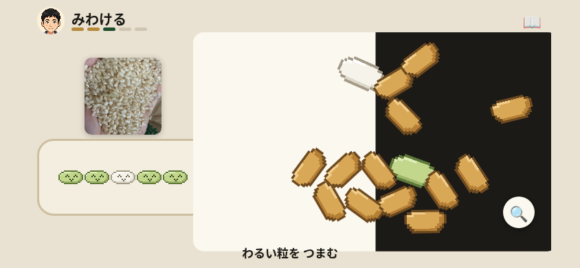
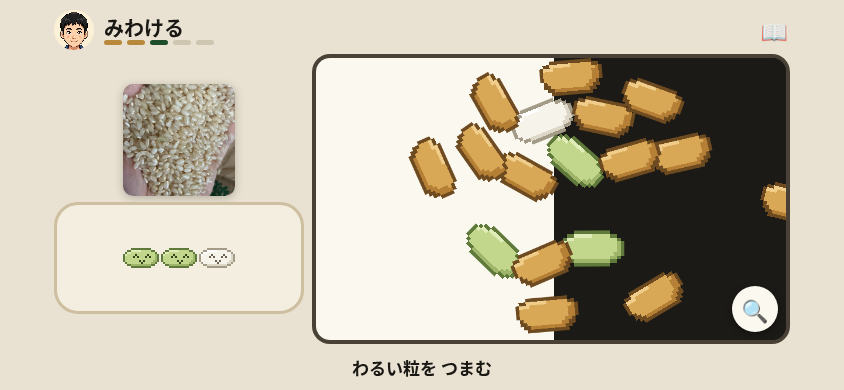

# 検査ゲーム：縮小中も皿の背景を枠内に収める

最初の 1 分で、➖ を押すと白黒の皿の背景が枠外へせり出し、左の写真・記録枠の周りまで広がった。画面が崩れたように見える点を離脱の候補とした。修正は `kensa.html:108` の CSS 3 行。既存の `.smooth` がある期間（通常は 480 ms、絵の補間は 450 ms）だけ皿を切り取り、class が外れた通常表示は従来どおりにする。実際の離脱率は測定していない。

## 発見と再現

2026-11-12、リポジトリ直下の `python3 -m http.server 8000` を Chromium で開いた。844×390、isMobile / hasTouch、CDP の指で 10 秒静観してから 60 秒遊び、10・30・60 秒の写真を保存。外部接続は遮断した。

発見時は操作 19、操作開始から 29.896 秒の ➖ タップ後。30 秒写真に背景のはみ出しが写った。見出しは読めており、見出しが隠れたとの判定ではない。

1. 穀刺しを左へさす、右へ抜く、ハンドルを回し、皿の場面まで進む。
2. 画面の手本どおりに粒を広げて寄り、見えている ➖ を押して戻す。
3. 縮小途中の画面と、皿の外の hit test を記録する。押す長さ 40 ms / 250 ms を各 5 回。

| 同じ数え方での確認 | 前 | 後 |
|---|---:|---:|
| 皿外の背景 201 画素が白い皿に変わった試行 | 10/10 | 0/10 |
| 皿外で背景 `plateInner` にヒットした試行 | 9/10 | 0/10 |
| 戻り終わると倍率 1・overflow visible | 10/10 | 10/10 |
| 入力エラー | 0 | 0 |

背景の判定は、各画像の皿外にある x=310、y=100〜300 の 201 点。前は紙色 RGB(233,226,210) が皿の白 RGB(251,248,239) に変わり、後は全 2,010 点で紙色を保持した。別の hit test の対象も背景 DIV であり、米粒のはみ出しを数えたものではない。粒配置は前後の新規プレイで異なる。

同じ 250 ms 操作の試行 2。写真の撮影要求〜完了は縮小開始後、前 131.4〜200.4 ms、後 135.5〜192.5 ms。実際に画像が取れた瞬間はこの範囲内。

| 前 | 後 |
|---|---|
|  |  |

[測定値と写真の SHA256](verification/kensa-zoom-return/results.json)

## 原因と確認

`kensa.html:1643` は論理上の倍率が 1 になると `.zoomed` を即座に外すが、絵は `:113` の 450 ms 補間で戻る。この間も既存 `.smooth` があるときだけ切り取る。class は既存の `:1637` で 480 ms 後に外れ、直接の指操作・場面変更・resize は既存の `applyZoom()` で解除される。動きを減らす設定では追加の切り取りを使わない。

追加した `tests/test_kensa_zoom_clipping.py:177` / `:183` は、実際の CDP 操作と皿外の hit test、動きを減らす設定の即時復帰を確認する。同一テストで旧 HTML は 2 件中 1 件失敗・1 件成功（12.034 秒）、修正版は 2 件成功（11.889 秒）。通常縮小の判定対象 15 フレームで背景へのヒットは 15 → 0。スキップなし。既存テストは変更していない。

修正後も 10 秒静観＋60 秒プレイを実施。35 操作中 35 操作で表示変化を記録し、観測上の無応答は 0/35。コンソールエラー・pageerror・入力実行エラーは各 0。最初の「ひきぬく」は操作開始後 0.137 秒の定期観測で確認（最初の touch から 0.125 秒以内という観測上限）。400 ms の操作後に取る別記録の 0.426 秒を、真の応答時間とは扱わない。最初の 1 粒を取れた確認は 6.027 秒、「きれいに なった！」は 8.327 秒。いずれも観測の上限で、前後の速度向上の根拠にはしない。

最初の 1 タップ、手動のつまむ／きめる、45 秒カード、見せる遊びの形、顔が見える倍率とズームの目標は変えない。これらを変える候補は運営者の判断に回す。傾きのセンサー・本物の指・回線の速さは実機未確認。`:has()` 非対応ブラウザでは今回の改善が適用されない。
