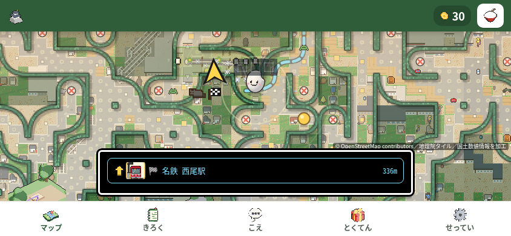
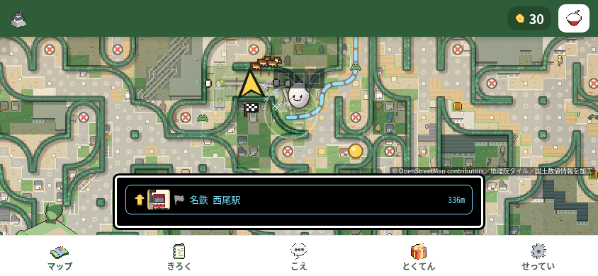

起動直後、題字の裏で未取得の世界地図を描く際、同じ霧タイルを1フレームに15,052回描いていました。最初の操作までの待ちにつながり得る処理として、霧の背景だけを既存画像の繰り返し模様で1回にまとめます。

`world` が未取得で、元画像16pxとの整数比になる縮尺だけが対象です。現在の大きさの2コマを保持し、画像が変われば更新します。それ以外の縮尺・pattern未対応時は元ループへ戻ります。カメラ・前景・当たり判定・案内・読込表示は後続で従来どおり更新します。

## 再現と変更前→後

1. リポジトリ直下で `python3 -m http.server 8000` を起動し、Chromiumで `http://localhost:8000/nishio-go.html` を開く。
2. 844×390、DPR1、isMobile/hasTouch、新しいcontext、遷移前にCPU4設定。Leafletは手元の `node_modules/leaflet/dist` に置換し、外部リクエストは送らない。
3. 題字が全面を不透明で覆うworldフレームで、`worldAvailable=false / worldState=building / trailCells=0` と背景描画を観測する。その後、表示中の案内の輪へCDP `Input.dispatchTouchEvent` で1回タップする。80ms・250msを各5回、合計10回。同じ凍結済みの観測コードを前後で使用。

| 指標 | 変更前 | 変更後 |
| --- | ---: | ---: |
| 対象フレームが得られた試行 | 10/10 | 10/10 |
| 大量の小タイル描画を観測した試行 | 10/10 | 0/10 |
| 対象1フレームの霧の背景 | drawImage 15,052回 | pattern fillRect 1回 |
| 80ms群／250ms群の問題再現 | 5/5・5/5 | 0/5・0/5 |
| タップ後の位置変化／非hiddenの30点DOM | 各10/10 | 各10/10 |
| 無応答／タップ後のworld移行 | 各0/10 | 各0/10 |
| console・page・HTTP・request・観測エラー | 0 | 0 |

変更前は対象44フレーム、変更後は28フレームを観測しました。背景の変更であり、境界線や文字を含むフレーム全体が1描画になるという意味ではありません。問題はタップ前に起き、保持時間を変えた両群で再現しました。

参考のDCL観測中央値は4,491.55→2,512.70ms。ただし描画を包む観測処理の回数・負荷も変わるため、非計測時の短縮量とは扱いません。down受信から位置変化の観測上限中央値は499.20→509.95ms、30点DOMは969.55→1,238.35msで、応答やごほうびが一律に早くなったとは主張しません。これらは周期観測の上限で、実画面に描かれた時刻ではありません。離脱率は測っていません。

通常の第53周（10秒観察＋60秒プレイ）は別の固定版 `450e6b5` で実施し、16/16操作で位置変化、無応答0、プレイ1.294秒に30点DOMを観測しました。10・30・60秒の写真も別記録です。この候補の10回比較は、前後ともmain `518459a8` を基準に揃えています。手の部位による入力の問題（#1126）はこの変更に含めていません。

## コードと回帰確認

- `nishio-go/pixel.js:8759`：霧専用の2コマキャッシュ、整数比の条件、元ループへのfallback。`:8789`：位相合わせとsave/finally restore。`:8811`：world背景への接続。変更前のタイル呼出はmain `pixel.js:8775`。
- `tests/test_nishio_fog_pattern.py:406`：通常／動きを減らす設定で、霧・前景・描画状態を確認。`:410`：pattern未対応時の元ループと両コマの背景画素を比較。
- 追加した同じ2テストを変更前ファイルで実行：9.873秒、`FAILED (failures=14)`（subtestを含む）。変更後：9.351秒、2/2成功。既存テストを削除・緩和していません。
- 隔離した画像比較は1,056/1,056ケースでRGBA差0（pattern384、元ループ672）。各実行の事前確認34/34成功。5画面由来の広いcanvas・正負の位相・両コマ・DPR由来のTを含みます。これは実ページを各DPRで遊んだ確認とは別です。
- 全ての整数Tをまとめる初案は、T3・f1・320×458で13,923画素の差が出たため棄却。元結果とPNGを保存し、整数比だけに限定しました。ブラウザ内部の原因は断定していません。

## 前後の画面

同じ844×390・80ms群の試行01。いずれも起動と1回の案内タップを観測した後の実画面写真で、最初のpaintやタップ瞬間の写真ではありません。

| 変更前 | 変更後 |
| --- | --- |
|  |  |

320×568・390×844・568×320・844×390・820×1180でも、前後それぞれ初期／案内タップ後の10状態と5回のタップを記録しました。計20状態・20原画で新しいviewport/祖先clip、操作の重なり、中心hit失敗、縦横scroll超過は0件。可視controlは66→65件で、差は844×390の一時的な「📱 OK」表示だった。既存の1,500ms後に隠す処理は前後同一で、実際のタイマー実行時刻までは測っていない。

## 残る検証と運営者の判断

- `pytest tests/` は前後とも実終了127、`pytest: command not found`。pytestが未導入のため実行できていません。
- 全unittest初回は2,530件、2,502成功・25失敗・2エラー・1skip、366.317秒、終了1。うち1エラーはローカルmain参照の欠落で、履歴の範囲検査に必要な比較元を別のローカルcloneに用意して再検証する。コミット済み差分を持つ別のローカルcloneでの全体再検証は未実行。この作業中の記録は、その結果を追記してからPRに掲載する。
- `node tools/playtest.js` は完走し実終了1。241群のうち成功211（boolean true 43＋ok:true 168）、失敗10、明示判定のない記録20、ページエラー0。失敗は roll・swipeHold・a2hsAutoHide・tapDemoQuick・infoSecondTap・infoRotate・restFinger・tiltDemoShown・godotRec・speedLines。過去の完走と比べて今回だけ失敗した名前はa2hsAutoHideで、原因は未確定。全成功とは扱わない。
- 前後計測はpixel `8c79616b…` → `b129130e…`。最終pixel `20c6c2dd…` は説明コメント1行だけを修正し、逆置換で計測版の全バイトが復元することを確認した。テスト `6e0a8205…` は不変で、最終版でも追加2件が8.242秒で成功。
- 運営者の判断・別作業として残す案：スクリプトの分割、world.jsonの後読み、読込中タップを保存して後で実行する案（既存の `docs/meiro.md:510`）。最初の実clickでの傾き許可、題字の解除時間、手本、始まり画面なし・到着カードなしは維持します。
- 実機では傾きセンサー、本物の指、端末の描画速度、回線速度を未確認。CPU4とCDPタッチは実機を校正した再現ではありません。

テスト失敗が残っているため、マージ・公開は保留する。
