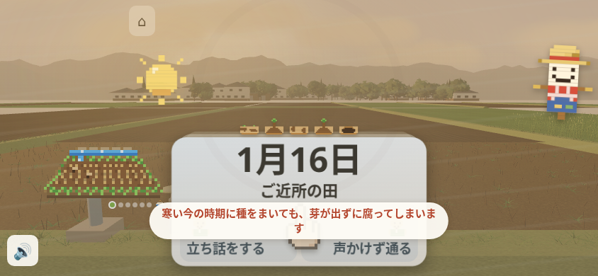
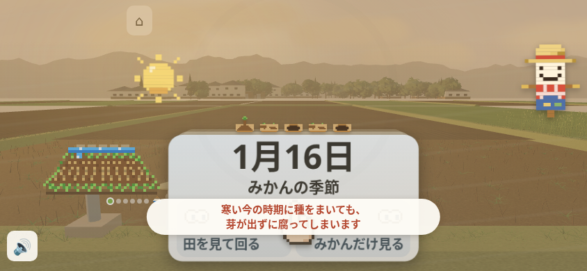

# 第66周：✗の理由の末尾1字だけの改行

2秒の✗説明で最後の「す」だけが次の行へ残り、短い理由を追いにくい場面を確認した。`kome365/index.html:639`の`#swWhy`へ`text-wrap:balance`を1宣言だけ追加した。補足再現は10/10→0/10、本文・箱の位置と寸法・2秒の指定を保持した。**対象の改行は改善したが、最初の1分全体や実際の離脱率の改善は未確認。全体テストの失敗が残るため下書きで保留する。**

## 数と原画

| 補足再現の観測 | 修正前 | 修正後 |
|---|---:|---:|
| 末尾1字だけの行がある | 10/10 | 0/10 |
| 120msの5枠 | 5/5 | 0/5 |
| 600msの5枠 | 5/5 | 0/5 |
| 対象27字の行配分 | 26＋1 | 全10回14＋13 |
| 箱の幅×高さ | 422.390625×52px | 同じ |

修正前10回の対象入力は補足プレイ65.430〜75.863秒、可読Rangeは67.516〜77.992秒。修正後は入力67.882〜78.399秒、可読Range69.794〜81.269秒。これは主観察の60秒写真で見た症状を繰り返した**補足再現**であり、最初の1分を10回測った数ではない。前後とも全10枠成立・実exit0、未成立を別の成功例へ置き換えていない。

| 修正前・補足試行1 | 修正後・補足試行1 |
|---|---|
|  |  |

両方とも844×390・120ms・1月15日「七十二候」で、見えている「種をまく」を選んだ後の未加工原画。新規contextのため、次の1月16日の題や絵・動きの位相は異なる。撮影瞬間や全画面の画素が同一の比較ではない。文は既存の`kome365/cards.js:463`に由来し、変更していない。

## 再現と最初の1分

リポジトリ直下で`python3 -m http.server 8000`を起動し、作業場のChromiumで`http://localhost:8000/kome365/index.html`を開く。844×390・isMobile/hasTouch・DPR1・CPU1、実Three128・Field3D・音を保ち、外向き要求を遮断する。

主観察は10秒無入力、その後60秒、見えるカードを左右へCDPの`Input.dispatchTouchEvent`で操作した。修正前は15操作すべてに60秒内のDOM反応と日付進行があり、1月16日へ到達。記録上の無反応0。最初の送信からDOM反応は7.440秒、最初の足跡・田んぼ反応は7.814秒（プレイ8.063秒）。送信待ちとゲーム処理は分け、capture pointerdown観測からDOM反応は4.0msだった。初回ACK待ちは5秒でtimeoutしたが、同じ入力の完了を回収した。

主観察は実exit1、console404が2件（記録されたresourceはlocalhost/favicon.ico）。pageerror・入力エラー・外部要求0。観察写真は撮影要求から約7.58秒遅れて完成したため、無入力10秒ちょうどの画像とは言わない。

修正後の主観察も完了・実exit1。16入力に対して60秒内の記録上のDOM反応16、日付進行15、最終1月16日。最初の送信→DOMは7.057秒、足跡・田んぼ反応は7.547秒。前後1回ずつの記述的な比較で、速度改善の因果は示さない。最後の入力は57.844秒、DOM反応59.645秒、trace停止60.060秒では1月16日。後の時刻付きでないextra読取だけが1月17日で、60秒内の進行へ足さない。

修正後の4原画に対象の理由文はなく、この自然プレイ写真だけでは改行の修正を確認できない。60秒写真は半透明で日付・文章・選択肢を読めない一瞬だったが、持続時間や停止・回帰は未確定。観察写真も要求から約7.717秒遅れて完成した。console404は2件、pageerror・入力エラー・外部要求0、全入力ACK・source5SHA・実3D/音・CPU復帰・ブラウザ終了は確認した。

補足は新規context10回を順番に開き、120/600msを交互に各5回。各回10秒観察し、可視カードを14回選んで1月15日へ進み、「種をまく」が見える側へ15回目をスワイプする。対象後は次の指を置かず、本文・行のRange・矩形・アニメーション・原画を記録する。保存・seed・日付・表示時間は書き換えない。修正前は150スワイプ、1200 CDP送信、trusted526イベント、console404が11件、pageerror0。起動時のuntrusted `bStart.click()`10件はプレイ入力へ加えない。

修正後も150スワイプ・1200 CDP送信・trusted526イベント＋起動時untrusted10件。対象前後の20原画を実見し、観察を含む30原画のSHAを照合した。全10回で全文27字、位置x=210.8046875/y=286、幅422.390625/高さ52は同一。computed CSSの差はwrap→balanceだけ、CSS2秒・animationend elapsedTime2秒も一致した。console404は11件、pageerror・外部要求0。これらは実機で途切れず2秒見えたことや、読解・離脱率改善を証明しない。

## テストと5サイズ

| 確認 | 実結果・状態 |
|---|---|
| 追加回帰を旧版で実行 | 1method内425ケース、末尾1字のassertで6失敗、4.060秒、exit1。[REDログ](red.log) |
| 同じ回帰を候補で実行 | 同じ1method内425ケースが成功、4.176秒、exit0。[GREENログ](green.log) |
| `pytest tests/` | 実exit127、`/bin/bash: line 2: pytest: command not found`。本体未実行 |
| 全体unittest | 2542methods＝2472成功・68失敗・1エラー・1skip、346.183秒、実exit1。新規why1件＋既存Komeブラウザ16件は成功 |
| 修正後の補足10回 | 全10枠成立・末尾1字0/10・実exit0。120/600msとも0/5 |
| 修正後の主観察 | 実exit1、16入力・DOM反応16・60秒内日付進行15、console404が2件 |
| 5サイズ前後比較 | 前後実exit0。数値15状態・操作部45→45、新しい問題0。可読原画比較14/15組、820の理由写真は未成立 |

追加テストは`tests/test_kome_why_wrap.py:128`、末尾1字の判定は`:182`。実indexのCSSを使う最小fixtureで、通常5サイズ×定数理由84文＝420ケースと、動きを減らす設定の対象文5ケースを測る。1methodと425ケースを合算しない。旧版の失敗は568×320・844×390・820×1180の両設定で、起動エラーではない。箱と文字領域が正の寸法を持ち、通常wrap対照と同寸で収まることも確認する。全画面・実3D・音・入力や、実際に2秒見えたことの証明には使わない。

全体unittestは既存offline shim・local Chromiumで`python3 -m unittest discover -s tests -v`を隔離cloneのa7ef8a11で実行した。69件の失敗・エラーは第65/57周と種別・完全名・順序が一致するが、原因の一致や全体成功は意味しない。唯一のskipは設計書不在。第65周の2545件との差は、このdc1由来の枝には未マージのにしお4テストがなく、今回why1件を加えた構成差で、既存テストを消した結果ではない。

GREENの実行時はHEAD dc1＋index変更・新規テストの2ファイル。後のcommit a7ef8a11は同じbytesを保存したもの。実行時HEAD/statusは親の実コマンド順序からの事後整理で、同時作成の独立証明ではない。最初のproofは後続台本の準備情報も含んでいたため、元記録を保持して明確化した。ログ・判定を変更していない。

修正前の5サイズは数値15状態・操作部45個で、中心hit失敗・viewport外・disabled・横scroll増0。15原画を実見したが、**820×1180の理由写真は薄い消え際で未成立**。可読写真14/15、理由写真4/5。別枠v2の820も数値3状態・操作部9個は成立したが、理由写真は再び未成立（可読2/3）。v1を置換せず、これ以上撮り直さない。数値だけで全5サイズの写真確認が通ったとは扱わない。理由と次カードの重なりは元からあり、入力透過と中心hitの結果を分ける。

修正後も数値15状態・操作部45個。前後30原画を実見し、新しい切れ・中心hit失敗・viewport外・無効化・重なり組・scroll増は0、理由の矩形は5サイズすべて一致した。安定した初期/次カードの30操作部も同じ矩形。理由表示時のカード3件だけ最大約2.15pxの差があり、入場アニメーションの位相差として分けた。820の修正後写真には理由が写らず、前後の理由写真1組は未成立のまま。可読DOM snapshotは成立するが、原画の成立とは混ぜない。console404は6→6、pageerror0。ホーム/音は中心hitの幾何確認で、機能を起動したテストではない。

## 運営者の判断と限界

初回の長い反応待ちは優先候補だが、3Dの準備時刻・方式は`kome365/README.md:848,851,853`の運営者判断へ残す。理由の位置・2秒・次の指で消す条件（同`:757,856`、`index.html:4003`）も変更しない。保護3ファイル、音、0.3秒の手本、タップで選ばない規則、30秒のカード、かかしと太陽は維持する。

実機のフォント・本物の指・傾きセンサー・回線速度、読解や次の正解、実際の離脱率は未確認。CSSの折り返しが初回の入力待ちを直すとは主張しない。固定SHA・実数・生記録のSHAは[results.json](results.json)。全体テストに失敗が残るため、[ricepia-flow/SKILL.md:212](https://github.com/shota0617/ricepia-judge/blob/dc1c9d2ee78fc8edf2e693e44f6117de23aab177/.claude/skills/ricepia-flow/SKILL.md#L212)の「Codex の 指摘が のこっている・テストが 落ちている・運営者の 判断が いる 変更は、マージせずに 伝える」に従い、マージ・本番公開を保留する。
