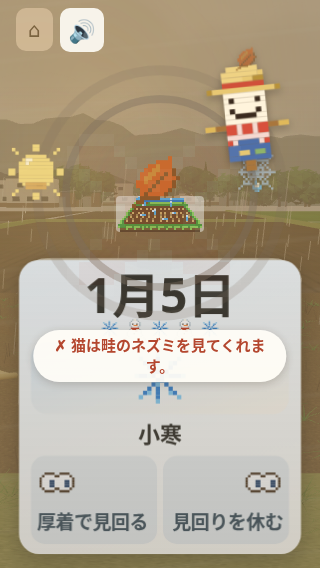

# 第90周：米づくり365・理由文の観察記録

main `823a532cf9f237582d7d12d4e0289658e2207b5b` を、320×568・CPU1・実3D・音ONで遊んだ記録です。製品と本体テストは変更していません。既存PR #1137の案を、このmainで検証した結果ではありません。

通常プレーの10秒写真では、猫の理由文の末行に **「す。」の2字**が見えました。続く固定10回では対象の全文に一度も到達せず、**厳格な再現判定の成立分母は0**です。「非再現0/10」「問題が解消した」とは言えません。

[数値・条件・根拠ハッシュ](round90-results.json)／[通常プレー10秒の原画](round90-primary-play10.png)

## 通常プレー1回

10秒観察の写真を保存した後、あらためて60秒遊びました。CDPの120msスワイプを右・左の順に繰り返しています。

| 観測 | 数 |
|---|---:|
| 入力／日付が進んだ回数 | 21／21 |
| 最後の日付 | 1月22日 |
| ○／✗ | 7／14 |
| 最初に続いた✗ | 5回 |
| 初めての○の理由をDOMで観測 | プレー14.7095秒／ナビゲーション開始30.1635秒 |
| 初CDP送信→カードtransform／翌日・理由をDOMで観測した上限 | 0.389秒／0.887秒 |
| 保存した原画 | 4枚 |
| 実終了コード | **1** |
| コンソールエラー | `/favicon.ico`の404が2件 |

初めての○と入力反応はDOM上の観測で、物理的な指・画素描画・聴取・理解の時刻ではありません。カードtransformはdrag classの観測時刻とも別の指標です。観察写真の保存に4.907秒かかり、遊びの時計は観察開始14.969秒後からです。この撮影待ちを製品の入力反応時間として数えません。ソース前後一致・CPUリセット・ブラウザ終了は確認できています。

対象は1月4日「田んぼの猫」の左「追い払う」で、全文は「✗ 猫は畦のネズミを見てくれます。」です。これは既存ゲームの表示の引用です（[固定mainの `kome365/cards.js:492`](https://github.com/shota0617/ricepia-judge/blob/823a532cf9f237582d7d12d4e0289658e2207b5b/kome365/cards.js#L492)）。写真では次の日の「1月5日・小寒」と同時に見えます。末行は「す。」の2字で、1字だけの行とは扱いません。写真要求はプレー10.0006秒、保存完了は10.4095秒です。通常プレーでは対象文の文字ごとのRange・専用の枠・撮影前後の不透明度を採っていないため、この1枚を厳格な再現数へ足しません。後の非表示理由文の矩形も流用しません。

## 補足の固定10回

同じmain・画面・CPU条件で、新しい環境ごとに右左を繰り返しました。対象の場面を内部状態や乱数の書換えで作らず、追加の補充試行もしませんでした。

| 要求スワイプ時間 | 実行枠 | 対象全文に到達 | 厳格判定が成立 |
|---|---:|---:|---:|
| 120ms | 5 | 0 | 0 |
| 250ms | 5 | 0 | 0 |

1月4日まで進んでも、実際の題や選択肢が通常プレーと同じとは限りません。全10枠は実行済みですが、対象の選択・全文へ到達していないため未成立です。再現率は計算できません。

成立には、最初の60秒以内の対象入力・配送・理由表示、撮影前後の全文Range、同じ表示回の不透明度0.5以上、画面内の文字・枠、撮影要求と完了、原画の全文と末行の判読などを求めました。成立した試行で、前後の計算と原画の末行が「す。」（文字index15・16）だけなら再現と数える定義です。旧来の1字判定は今回の主判定に使いません。

- 入力211回、日付進行211回、記録上の無反応0。CDP命令1688件すべてACK、保存pointer738件すべてtrusted。全物理イベントの数へは読み替えません。
- 独立監査は保存された定時原画40枚を実際に確認。対象の追加原画は0枚です。
- 理由表示211回のうち、60秒以内のCSS復帰を207回観測。残る4回は60秒末までにoffを観測できず、表示時間の故障4件とは数えません。
- 実子終了は全10枠が**1**、rootのbatchも**1**。`/favicon.ico`の404コンソール20件、page error0。エラーは隠していません。
- ソース5ファイル、各CPUリセット・ブラウザ終了、9か所の直列境界は確認済み。既知のfaviconだけのエラーを条件付きで扱う定義でも、実exit1を成功には変えません。対象未到達は別の理由として全枠を未成立にします。

## 最初の1分についての仮説

- **A・小修正候補**：既存の理由の中に、対象日の短い識別を添える。前日の理由を今のカードの理由と取り違える可能性への案です。理由本文・吹き出しの場所と2秒は保ちます。未実装で、今回の対象文の再現検証とは別の仮説です（`kome365/index.html:3815,3829,3836`）。
- **B・運営者判断**：初手を左から案内するかは、答えを教えることになるためREADME639が判断待ちとしています。3D開始方針も既存判断として保持し、今回の撮影待ちやソフト描画の時間から実機向け変更を決めません。手本0.3秒・音・かかし・太陽も変更していません。
- **C・大設計候補**：21枚後も「田おこし まえ」で、近い達成や次の段階が見えにくいことから、冬支度の短い目標・報酬・その先をまとめて検討する案です。禁止されたengine/field3d/cardsや、運営者が外した表示には手を付けていません。

## 今回していない検証

製品修正、回帰テストの本体追加・実行、`pytest tests/`全体、5サイズ確認、RED/GREEN、修正前後比較は今回行っていません。scratchのテスト草稿は未採用・未実行です。PR #1137の旧案の有効性も、この記録では検証していません。

実機の指・傾きセンサー・GPU・回線・実際の音・人の理解や離脱率は未確認です。撮影とDOM観測は連続2秒の物理描画を保証しません。通常プレーと補足10回は観測の負荷も異なり、速さの因果比較には使いません。

元PNGをそのまま保存しています。SHA-256は `fd9fa5a16c686efddf4869322531a857794efca972b7f4e9fc11792974278371`。補足監査の確定ハッシュはresults内に保存しています。
