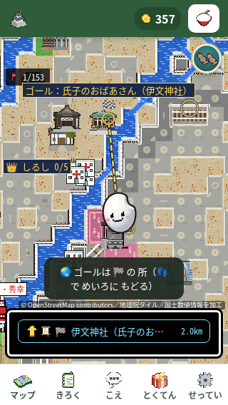
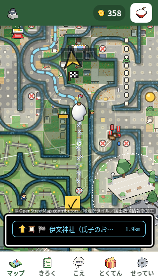

> 第65周の追加確認は[第65周の記録](round65-README.md)を参照。世界地図への誤遷移は減ったが駅情報画面が残り、最初の1分全体の改善は確認できなかった。以下は条件の異なる第57周の既存記録。

# 通常の手本中央から世界地図へ移る問題の確認

通常の手本の中央を押しても歩かず、世界地図へ切り替わった。手の押下アニメーションで中央が移動する範囲と、クリックの整数丸めを置き場所の優先判定に加えた。同じ再現手順で誤遷移 **6/10 → 0/10**、歩行 **4/10 → 10/10**。実際のプレイヤー離脱率は測っていない。

| 予定保持時間 | 修正前の誤遷移 | 候補の誤遷移 |
|---|---:|---:|
| 80ms | 3/5 | 0/5 |
| 250ms | 3/5 | 0/5 |

実測は2026-11-12 UTC、main `dc1c9d2e` と、その上の候補 `pixel.js` を比較した。ソースSHA・全20試行の座標/結果/観測窓/写真SHA・実コマンド/終了コードは [results.json](results.json)。大きい生ログは追加せず、元記録のSHAを残した。

## 再現と数え方

リポジトリ上で `python3 -m http.server 8000` を動かし、作業場のChromiumで `/nishio-go.html` を開く。320×568、isMobile/hasTouch、DPR1、移動前にCPU4のACK。Leafletは手元の部品へ差し替え、その他の外部要求は外へ送らず空応答にする。

10秒眺めた後、見える手本の実DOM矩形中央をCDPで押して自然に2到着まで進む。その後の通常手本を80/250ms交互に各5回。worldになったら見える「👣」で戻る。内部配置・状態リセット・センサー偽装は使わない。各試行に入力完了後1100msの観測窓を取り、全10試行で窓後の写真を保存した。最大180秒、10機会不足は未検証とする。

「歩いた」は操作前からの緯度/経度変化を観測したもの。「誤遷移」はworld=falseからtrueの観測。戻る操作は座標移動がなくてもworld=falseなら成功で、無応答へ混ぜない。入力ACK・pointer/click座標・観測窓・写真・CPU復帰・ブラウザ終了は別々に確認した。

1コンテキストで自然に進むため、成功した後は位置と手本が変わる。修正前は最初の7試行が同じanchorで、7回目に歩行し、以後は別の手本。固定した同じ10地点の比較ではない。配置後に変わる背景、本物の指の広さ、全端末まで安全を保証しない。

## 原画

同じ番号の試行、同じ観測窓後の原画。撮影までに点数は進みうる。

| 修正前：試行1は世界地図 | 候補：試行1は歩く地図 |
|---|---|
|  |  |

全10枚を各版とも目視確認した。修正前の1〜6は世界地図、7〜10は歩く地図。候補は全10枚が歩く地図。追跡する画像はこの2枚だけで、残りの原画SHAはresultsにある。

## 通常プレイと修正箇所

別の第57周の10秒観察＋60秒プレイでは、17操作＝手13（歩行9、誤遷移4）＋戻り4成功。最初の30点DOMは0.9687秒。補足再現は60秒を超えるため、この最初の1分の数へ混ぜない。第53周はソース・画面・保持時間が違い、今回の改善比較には使わない。

- `nishio-go/pixel.js:9558`：通常手だけ、丸めた配置座標を基準に中央の全整数位置を確認。CSSの下向きは+17〜33px、反転時は−33〜−19px。
- `nishio-go/style.css:1062`、`:1070`、`:1082`、`:1086`：中央の原点・縮小・14px移動の根拠。CSS自体は変えていない。
- `nishio-go/pixel.js:9628`：従来の20px確認と、中央を安全に置けないときのplain fallbackを残す。最後の手本を消さないが、fallback時の中央の安全は保証しない。
- `tests/test_nishio_moving_hand.py`：実記録の矢印重なり、途中の中央・丸め、初回/通常/最後の候補の境界を行動で確認。

応答時間は、入力前座標・整数クリック座標が一致した最初の7準備操作で、送信から座標変化の観測までの中央値519.0→518.5msだった。ただし各版1回で、操作6・7は候補の方が遅い。微差や速度改善、悪化がないことは主張しない。追加した方向ごとの最大17点／15点の判定について、関数自体の時間と最悪負荷は未計測。要点と元集計SHAは results の `performance` に残した。

## 検証状況

| 確認 | 実結果 |
|---|---|
| 新規回帰テスト | 修正前3methodsに5失敗表示（3subtests＋2methods）、0.816秒・exit1。候補3/3成功、0.654秒・exit0 |
| 関連する既存テスト | 85/85成功、4.352秒・exit0。消去・緩和なし |
| 修正前/候補の自然再現 | 各10試行・5+5・全観測窓/写真成立、各exit0、記録エラー0 |
| `pytest tests/` | 実行したがexit127：`/bin/bash: line 1: pytest: command not found` |
| `node tools/playtest.js` | 実終了exit1。247確認群＝明示成功216・明示失敗11・判定なし20、errors配列0件 |
| 5画面の重なり/押下 | v1は前後各18/20・exit1、390×844補足v2は各4/4・exit0。22観測組／20種類。詳細は下記 |
| lowGoalDemo / lowDemoKept追加比較 | 前後とも2群中1成功・1失敗、各exit1。元の通し11失敗を保持 |
| Python全体（unittest） | 2,544件＝2,474成功・68失敗・1エラー・1スキップ、357.214秒・exit1。新規3件も成功 |

Python全体は独立したコミット済みチェックアウト（8fcbefd）で2,544件を実行し、2,474成功・68失敗・1エラー・1スキップ、357.214秒・exit1。新規3テストはこの全体実行でも成功した。第53周の全体実行と69個の失敗・エラーの名前と種別は一致し、追加・消失は0。ただしmainとテストの版が異なるため、原因まで同一・すべて既存不具合とは断定しない。

ブラウザ通しで失敗した11項目は `roll`、`swipeHold`、`a2hsAutoHide`、`tapDemoQuick`、`lowGoalDemo`、`infoSecondTap`、`lowDemoKept`、`restFinger`、`tiltDemoShown`、`godotRec`、`speedLines`。247は確認群の数で、成功216はboolean trueまたはok:true、判定なし20は数値等の記録で成功・失敗のどちらにも数えない。errorsが0でも、全体はexit1で失敗した。第53周とはmainとtools/playtest.jsの版が違うため、失敗名の増減だけで今回の回帰とは断定しない。追加比較の結果は以下に分けて記録する。

同じdc1の工具でlowGoalDemo・lowDemoKeptを各版1回ずつ追加比較した。前後とも2群中1成功・1失敗、実exit1。lowGoalDemoは双方とも568×320・残り1マスで手本が出ず、残り3条件では表示した。lowDemoKeptは隔離実行では双方成功したが、通し実行での失敗原因は未確定。元の通し11失敗は取り消さない。既存の内部配置を使うチェックなので自然な60秒プレイとは別で、各版1回の時刻差から速度や全条件の同等性は主張しない。

5サイズの最初の比較v1は前後とも18/20場面・実exit1。390×844の世界地図と戻りだけ機会不足で、通常手の移動は各5/5だった。390×844だけ操作順を変えた補足v2は前後とも4/4場面・4実入力成立、各exit0。合計22観測組は5サイズ×4状態の20種類を含み、390の初回・通常手が重複する。v1の未成立とexit1は消していない。

成立したv1の18組とv2の4組では、操作部観測117→117、26→26。新しい矩形の切れ・操作部間の重なり・中心hit失敗・disabled・scroll超過・手ホストの画面外は0だった。写真と測定は時刻が異なり、全画素・全操作点の保証ではない。56原画ファイルを実際に開いて確認し、この範囲で新しい手本・札・操作部の切れや重なり増加は見つからなかった。568×320の戻り画面では案内文が下部タブに重なるが、これは既存コード（pixel.js:9067、style.css:501）に明記された透過配置で、前後とも同じ方針。新規不具合や押せない状態とは扱わず、変更する場合は運営者判断とする。

テスト失敗が残るためマージを保留する。[ricepia-flow/SKILL.md:212](https://github.com/shota0617/ricepia-judge/blob/dc1c9d2ee78fc8edf2e693e44f6117de23aab177/.claude/skills/ricepia-flow/SKILL.md#L212) の「Codex の 指摘が のこっている・テストが 落ちている・運営者の 判断が いる 変更は、マージせずに 伝える」に従う。 検証の実コマンド・結果のSHAはresultsに保存した。unittestの実行でpytestの未導入や通しブラウザの失敗を成功扱いにはしない。

運営者判断に触れる、通常手の拡大・通常手全体への支援拡張・矢印を直接押したときの規則変更は採用していない。初回の許可と大きい手本、止まったときの手本、開始画面なし、到着カードなし、既存fallbackは保持。実機の傾きセンサー・本物の指・回線速度・物理画面は未確認。新しい地理等の事実や外部サービスの変更はない。
