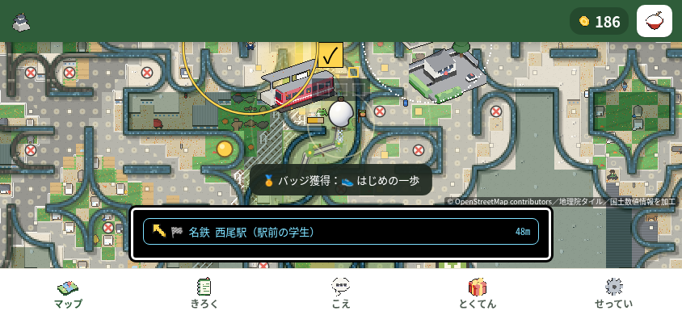
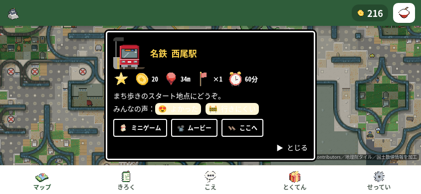

# 第65周の追加確認：最初の1分の総体改善は未確認（本番公開保留）

通常の動く手本の中央を押す手順を844×390で前後10枠ずつ比較した。世界地図への誤遷移は減ったが、修正後の全10枠に駅情報画面が見えた。**最初の1分全体が改善したとは結論しない。マージ・本番公開は保留。**

表の修正前は11行の初回修正後（pixel cd155…）、修正後は14行追加後（pixel 5a4f…）。PRの元baseから25行すべてを比較した表ではない。

| 同じ10枠の観測 | 修正前 | 修正後 |
|---|---:|---:|
| 世界地図への誤遷移があった枠 | 9/10 | 0/10 |
| 誤遷移／通常手入力（初回・戻りを除く） | 11/136 | 0/100 |
| 30/60秒原画に駅情報画面が見えた枠 | 3/10 | 10/10 |
| 世界地図か駅情報画面のどちらかを確認した枠 | 10/10 | 10/10 |
| 終了時の保存goals=1 | 3/10 | 10/10 |
| 終了時の保存goals=2 | 7/10 | 0/10 |

修正前のworld9枠と情報画面3枠は2枠で重なる。情報画面数は30/60秒の少なくとも1枚で見えた枠数で、開いた回数ではない。台本は「とじる」を押さないため、修正後の216点・goals=1の継続をゲーム停止や実際の離脱率とは扱わない。座標反応も入力ごとの前進を証明しない。

## 同じ試行・予定時刻の原画

試行2（250ms）・予定play30秒の未加工原画。修正前は歩く地図、修正後は駅情報画面が見える。worldの集計は時系列JSON、情報画面の集計は30/60秒の原画に基づく。

| 修正前：試行2・play30秒 | 修正後：試行2・play30秒 |
|---|---|
|  |  |

## 追加変更と再現

PR全体の製品変更は`nishio-go/pixel.js`への25行追加（動く中央の判定11行＋今回の候補探索14行）。今回分は`:9633`から14行を追加。既存9点×全対象セルで手の動く中央まで安全な候補がなく、18pxの余裕を持つ通常plainがある場合だけ、各セルの4内点（0.5/0.5、1.5/0.5、0.5/1.5、1.5/1.5）も調べる。near40・指先18px・既存20px中央・動く中央・実fieldHitの判定を通るhandを`:9643`で採用し、なければ元plainを返す。最大追加28座標は処理時間の上限ではない。

既存整数候補の優先、初回true/big、slop0、route plainがない時のgoal/nullを保持する。入力処理・傾き許可・支援半径・旗・タイマーのコードは編集していない。ただし配置と後の経路は変わる。

リポジトリ上で`python3 -m http.server 8000`を起動し、Chromiumで`http://localhost:8000/nishio-go.html`を844×390・isMobile/hasTouch・DPR1・CPU1で開く。Leafletは手元へ差し替え、外部へ接続しない。新規contextで10秒観察後、60秒間、見える手本のDOM中央をCDPの`Input.dispatchTouchEvent`で押す。worldになれば見える戻りを押す。80/250msを交互に各5枠、前後で同じ数え方。内部配置やゲーム状態は書き換えない。

| 指の保持設定 | 修正前world枠／通常手の誤遷移 | 修正後world枠／通常手の誤遷移 |
|---|---|---|
| 80ms | 4/5枠・6/64入力 | 0/5枠・0/50入力 |
| 250ms | 5/5枠・5/72入力 | 0/5枠・0/50入力 |

前後とも10枠完了・実exit0。修正後110手入力（初回10＋通常100）は座標反応100、記録項目だけの無変化10。全枠のsource前後・HTTP・台本・入力条件・CPU設定/復帰・ブラウザ終了・4写真が成立し、trusted330/330、console/page error・期限後入力・分類不一致0。修正後40写真のSHAを照合し、前後それぞれ30/60秒の20原画を実見済み。記録項目の無変化は情報画面の表示変化を含みうるため、視覚無反応とは呼ばない。

修正後の最初の30点DOMはplay0.3387〜0.6097秒、保存goals=1は22.8082〜25.1122秒に観測した。歩数・tapGoal・入力ごとの残距離は元台本で未計測。次の操作と、その先へ進めるかの確認が残る。

## 分母へ混ぜない診断と単発確認

修正前の250ms条件ログ付き診断2回は、各18操作・通常手16・world1・情報画面観測0・実exit0。両方のaction8でslop18/hand=false/goal=falseのplainを採用し、指先約(470,70)に対して動く中央(470,103)が矢印内へ入り、座標不変からworld=trueになった。この2件は前10枠の11件とは別で、情報画面の原因も確定しない。

2回目のsnapshotは必要幾何75点の独立再計算と一致した。整数候補0/27、広いhalf-step表3/48、最終4内点の部分集合2/12。追加点はこの診断で採用・タップしておらず、実fieldHitや歩行の証明ではない。条件ログの負荷があるため速度比較にも混ぜない。

修正後の80ms単発確認は11手入力・座標反応10・world0・記録項目無変化1・実exit0。30/60秒原画は駅情報画面・216点。最初の30点は0.3859秒、保存goals=1は22.7873秒に観測した。

## テストの版と実結果

`tests/test_nishio_hand_midpoints.py:208`は記録幾何で実tapDemoSpot/Layout/Walksを動かす。fieldHitはnull、DOMは矩形へ簡略化しており、実ゲームの全面的な当たり判定は証明しない。配置優先の互換8ケースは同じ1メソッド内のsubTest。

| 確認 | 実結果／状態 |
|---|---|
| 最終テスト48dd…を旧3bd／pixel cd155…で実行 | 1test・1failure・exit1。動く中央55点が矢印へ入るassert失敗。[REDログ](round65-red-final.log) |
| 最終テスト48dd…を候補pixel 5a4f…で実行 | 主回帰＋互換8ケースを含む1test成功・0.166秒・exit0。[GREENログ](round65-green-final.log) |
| 関連unittest | 99/99・4.948秒・exit0。新規テストは初版425090…の時点。[関連ログ](round65-green-related99.log) |
| `pytest tests/` | commit5562352で実exit127：`/bin/bash: line 9: pytest: command not found`。テスト本体は未実行 |
| `node tools/playtest.js` | 実exit1。247確認群＝明示成功217・明示失敗10・判定なし20、errors0。失敗を保持 |
| Python全体unittest・初回 | 2530件実行・68失敗・1エラー、skip報告4（個別2＋クラス2）、93.738秒・実exit1。Chromium未起動の2クラス15メソッドは未実行 |
| Python全体unittest・最終 | 同じcommit5562352の隔離clone、既存offline shimとsystem Chromiumで2545件＝2475成功・68失敗・1エラー・1skip、346.504秒・実exit1 |
| 320×568・390×844・568×320・844×390・820×1180 | 実exit0。20状態・操作部130→130、新しい切れ/重なり/中心hit失敗/無効化/scroll増0。通常手・直接矢印・戻りは各5/5→5/5。前後各25原画を実見 |

通しnodeの失敗は`swipeHold`、`a2hsAutoHide`、`tapDemoQuick`、`lowGoalDemo`、`infoSecondTap`、`lowDemoKept`、`restFinger`、`tiltDemoShown`、`godotRec`、`speedLines`。開始前後の8ソースSHA・HEAD556・cleanが一致した。元tool session72021は失われたが、元node PID481652と親shellは同じ1回を継続し、observerが04:16:20 UTCに元shellのexitファイルから1を回収した。再実行や元tool sessionからの直接回収ではない。同じtoolの第57周216成功/11失敗/20判定なしから`roll`だけ成功へ変わったが、変更の因果は未確認。

全unittest初回は対象のにしお4メソッドが成功したが、Chromium未起動による3skip（個別1＋クラス2）があり、2クラス15メソッドが実行されなかった。クラスskip2は2530件の外で報告されるため、成功数は2459。初回ログ・実exit1を残し、同じテストを既存offline shimと`/usr/bin/chromium`で再実行し完了した。テストの削除・緩和はしていない。 最終実行では追加回帰1件と前のmoving-hand3件が成功し、クラスskipは0。唯一のskipは設計書不在のruler確認。第57周と69件の失敗・エラーの名前・種別・順序は一致するが、原因まで同じとは断定しない。

関連99件は初版425090…で、最終版48dd…の単体1件と合算しない。関連ログ単体にSHAがないため、実行transcriptに基づく[事後の実行記録](round65-related99-run.json)と前後freeze記録で版を照合した。これは同時作成の単独source証明ではない。正確な標準入力と作業場所は実行記録にある。RED/最終GREENは`python3 tests/test_nishio_hand_midpoints.py`。REDは`NISHIO_SOURCE_ROOT`に旧3bdの隔離コピーを指定した。

5サイズの比較元は旧pixel cd155の旧v1成功4サイズと旧v2の390×844。旧v1の390未成立・全体exit1は旧記録へ保持する。今回の実行はHEAD3bd＋pixel5a4f/test48ddでsource前後ゲート一致し、終了後のcommit5562352でも製品・テストbytesは同一。新しい4内点が全サイズで実採用されたことや、全入力の結果は証明しない。

568×320の戻り説明と下ナビの重なりは前後共通。820×1180の戻りでは計測時に手本が非表示でも、約866ms後に保存完了した原画には通常手が見える。別時刻の記録であり、持続する手本欠けとは判定しない。

## 限界と運営者の判断

旧第57周320×568の6/10→0/10は別条件で、今回へ合算しない。前後の経路・位相は異なり、修正前だけworld直後の追加撮影があるため、速度の因果比較はできない。物理画面の表示、本物の指、傾きセンサー、回線速度、実際の離脱率は未確認。

最初のclickで一度だけ傾き許可、聞く前と停止時の手本、開始画面なし、到着カードなしは維持。通常手の拡大・支援範囲拡張・直接矢印の規則変更は採用していない。駅情報画面を自動で閉じる等は追加せず、原因の追加観測と、必要なら運営者の判断へ回す。

固定SHA・枠別記録・診断・ログの版とSHAは[round65-results.json](round65-results.json)。第57周の[results.json](results.json)は変更しない。通しnodeと全unittestの失敗が残るため、[ricepia-flowの規則212](https://github.com/shota0617/ricepia-judge/blob/dc1c9d2ee78fc8edf2e693e44f6117de23aab177/.claude/skills/ricepia-flow/SKILL.md#L212)の「Codex の 指摘が のこっている・テストが 落ちている・運営者の 判断が いる 変更は、マージせずに 伝える」に従い、マージを保留する。
