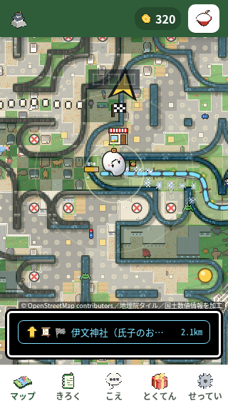
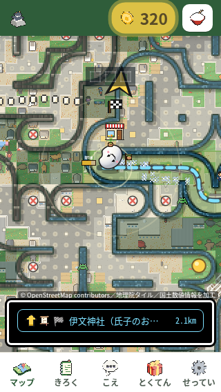

# 第69周：通常の手本中央から世界地図へ移る場面

**通常手からの世界地図への誤遷移は今回の10反復で4/10→0/10。全体unittestと必須node通しに失敗が残るため、PRは下書き・本番公開保留です。**

動く通常の手本の中央を押したつもりで世界地図へ切り替わると、次に何をすればよいか迷いやすくなる。現mainの主観察では通常手15操作中3回、別の10反復では4/10回に計5件を確認した。画面は変わっており、フリーズや無反応とは数えない。

既存PR1133の25追加行を最新main `f10bb2cf155e5643b41c7e4e3b6a1afca95484ca` と統合した。第69周では製品パッチや重複テストを追加していない。検証したlocal HEADは `c35d8e242d44e519d92b01fc560f41b790ec4080`、treeは `3efff8853cde56d704d58b9d89971e69628999d8`。同じcode treeのremote objectは `0526f104bba024a07b59d99093e4b45ef3f08a11`。後続の公開commitは検証記録を追加する版として、実行したcode版と分ける。

## 変更と再現

`nishio-go/pixel.js:9558`で通常手の動く中央を整数丸め込みで判定する。`:9633`では既存候補が足りず18px余裕のplainがある場合だけ、セル内4点を追加探索する。指先・通常の中央・動く中央が安全な候補を選び、見つからなければ従来のfallbackを残す。すべての手本が常に安全になる保証ではない。

リポジトリ先頭で `python3 -m http.server 8000` を動かし、Chromiumで `/nishio-go.html` を320×568・isMobile/hasTouch・DPR1・CPU1で開く。Leafletは手元の部品に差し替え、外部接続を止める。新規contextで10秒観察後、60秒間、見える手本のDOM中央をCDP `Input.dispatchTouchEvent`で押す。世界地図なら見える戻り、情報画面なら見える「とじる」を押す。80/250msを交互に各5回。内部状態や配置は書き換えない。

| 独立した10反復 | 現main・修正前 | 統合候補・修正後 |
|---|---:|---:|
| 成立した回 | 10/10 | 10/10 |
| 通常手から世界地図へ移った回 | 4/10 | 0/10 |
| 80ms | 2/5回・3件 | 0/5回・0件 |
| 250ms | 2/5回・2件 | 0/5回・0件 |
| 通常手の誤遷移／通常手入力 | 5/122 | 0/133 |
| 情報画面／記録上無反応 | 0／0 | 0／0 |

修正前は137入力、411/411イベントがtrusted、274件のCDP送信。全入力に1100msの観測窓が成立し、戻り5/5が応答した。console/page/inputエラー0、未成立・置換0。実exit0、各回の前後で7local SHA・5HTTP SHAが一致し、CPU復帰とブラウザー終了を確認した。40PNGのSHA・寸法は確認したが、全40枚を目視したとは記載しない。短い世界地図区間を含む写真候補はなく、誤遷移の証拠は入力と状態の時系列である。

修正後10回も独立最終監査済み・実exit0。143入力（通常手133）、429/429イベントtrusted、CDP送信286。1100ms完全窓142＋未完窓1で、4回目の最後の入力はplay59.594秒に送信、59.9512秒に座標反応し、解放/完了も60秒内。未完窓を無反応や完全窓に数えない。情報表示・戻り・console/page/inputエラー0、未成立/置換0。前後のsourceゲート・CPU復帰・終了は全10回成立した。

修正後も40PNGのSHA・寸法を照合し、短いworld区間を写す原画はない。全40枚を目視したとは記載しない。保存ゴール1は全10回、保存ゴール2は前2/10→後4/10だが、後半の場面や乱数が異なる観測値として扱う。250ms群の最初の30点は509.9〜585.3ms→495.8〜662.1msであり、報酬が速くなったとの主張はしない。

## 別の主観察1回ずつ

| 最初の60秒・80ms | 修正前 | 修正後 |
|---|---:|---:|
| 入力 | 19（手16、戻り3） | 15（手15） |
| 世界地図／情報画面 | 3／0 | 0／0 |
| 座標反応 | 13 | 15 |
| 最初の送信→座標反応 | 139.2ms | 134.0ms |
| 最初の送信→見える30点 | 373.8ms | 373.4ms |
| 保存ゴール1の最初の観測 | play23.9241秒 | play23.9431秒 |
| console/page/inputエラー | 0 | 0 |

前は18個の完全な観測窓と最後の未完窓1個。最後の入力にも60秒内の座標反応があり、完全窓の無反応は0。後は全15窓が成立し、無反応0。両方とも実exit0、source前後・CPU復帰・ブラウザー終了を確認した。初反応や点数の時刻は観測値で、物理画面の描画時刻や離脱率改善ではない。座標変化も経路の前進を証明しない。

### 同じ予定時刻の未加工原画

| 前：play30.001〜30.106秒 | 後：play30.000〜30.094秒 |
|---|---|
|  |  |

両方320点の歩く地図。前の世界地図区間はplay36.2452/38.7772/41.3154秒から始まり、上の写真には写っていない。写真だけで誤遷移の前後差を示したとは扱わない。前後各4原画は実見・SHA照合済み。30/60秒では目的地名は省略されるが距離は読める。

## テストと公開条件

| 実行 | 現在確認できる結果 |
|---|---|
| `test_nishio_moving_hand.py` を現mainへ | 3 methods、5失敗表示、実exit1。[RED](round69-red-moving.log) |
| `test_nishio_hand_midpoints.py` を現mainへ | 1 method、1失敗、実exit1。[RED](round69-red-midpoints.log) |
| 同じmoving testを統合候補へ | 3/3成功、実exit0。[GREEN](round69-green-moving.log) |
| 同じmidpoint testを統合候補へ | 1/1成功、実exit0。[GREEN](round69-green-midpoints.log) |
| `pytest tests/` | 実exit127：`bash: line 1: pytest: command not found`。本体未実行。[ログ](round69-pytest.log) |
| Python全体unittest | 2556件＝2486成功・68失敗・1エラー・1skip、473.318秒、実exit1。既存Nishio回帰4件は明示成功 |
| `node tools/playtest.js` | 247群＝明示成功215・明示失敗12・明示判定なし20、errors0、実exit1。通常の最後まで実行 |
| 320×568・390×844・568×320・844×390・820×1180 | 実exit0。20状態・操作部130→130、中心hit130/130、新しい切れ/無効化/hit失敗/操作部間重なり/操作部矩形/scroll差0 |

REDは `NISHIO_SOURCE_ROOT=/workspace/ricepia-current-firstminute python3 /workspace/ricepia-nishio-moving-hand/tests/対象名.py`、GREENは環境変数を `/workspace/ricepia-nishio-moving-hand` にして同じファイルを実行した。テストSHAは不変。`tests/test_nishio_moving_hand.py:89,112,138`は記録された矢印との重なり・アニメ途中と整数丸め・fallbackと初回境界、`tests/test_nishio_hand_midpoints.py:208`は横画面の記録幾何と互換8ケースを検証する。実関数を使うNode fixtureであり、DOM/fieldHitの簡略化があるため実ゲーム全体の証明と分ける。

5サイズは第65周の歴史的候補記録との比較で、現mainの新しい修正前計測ではない。旧手順と同じCPU4・250msで、主観察/10反復のCPU1条件とは分ける。実際のCDP入力は20、通常手移動・直接矢印・見える戻りは各5/5。130中心hitを130回の実押下とは呼ばない。9local/6HTTP・helper/config/Leaflet・CPU復帰・context/browser終了が成立した。

新しい25原画を実見し、568×320 returnedの旧原画1枚も確認した。説明と下ナビ中央の重なりは前から同じで、操作部同士の重なり0とは別の見え方である。手本landmarkの差は7状態（動く矩形6、568 returnedの計測時非表示1）。後者は約434.23ms後に保存完了した原画で手本が見え、恒久的な欠けとは扱わない。旧新50PNGのSHA照合を50枚の目視としない。

全体unittestは隔離cloneのc35で `python3 -m unittest discover -s tests -v` を実行した。544 classes、fixture失敗/skip・未分類0、唯一のmethod skipは設計書不在のruler確認。失敗69件は第65/66周と名前・種別・末端例外型・順序が一致するが、例外本文は第65周比30件/第66周比66件で異なり、原因一致とはしない。分類は変更ファイル制限65件、pixel exportの文字列2件、tractor progressの文字列1件、同regex結果のNone参照1件。既存テストは緩めたり削除していない。

全体件数はlocal c35をHEADにした実行の結果である。同じcode treeのremote `0526f104bba024a07b59d99093e4b45ef3f08a11`で別実行した結果ではない。後続の記録だけの公開commitは、そのHEADとして全体テストを実行していない。変更範囲検査の一部は `HEAD~1` に依存するため、後続の履歴へこの失敗件数を付け替えない。

source/cloneは前後・独立確認でcleanかつ同じHEAD/tree、305 tests＋選択8 sourceの313 SHAが一致。第65周より11件、第66周より14件多いのはmain由来Kensa2＋Kome9、Nishio4、別候補why-wrap1の不在による版構成差で、今回テストを削除したためではない。

全体テストの失敗が残るため、マージ・本番公開を保留した下書きを保持する。 [ricepia-flow:212](https://github.com/shota0617/ricepia-judge/blob/f10bb2cf155e5643b41c7e4e3b6a1afca95484ca/.claude/skills/ricepia-flow/SKILL.md#L212) の「Codex の 指摘が のこっている・テストが 落ちている・運営者の 判断が いる 変更は、マージせずに 伝える」に従う。上記は今回の実行結果で、過去の失敗数を転記したものではない。

node通しの実コマンドは `node tools/playtest.js /workspace/scratch/first-minute/round-69/validation/node-playtest`、cwdは同じ隔離clone。固定日付・状態を使う既存回帰suiteで、自然な主観察や10反復とは分ける。1つの最上位groupを1判定とし、入れ子のboolean/caseを加算しない。判定なし20群は未実行を意味しない。stdout JSONと保存JSONが一致し、scriptStoppedやcrashはなく、正常full pathの末尾まで到達した。

失敗群は `roll`、`swipeHold`、`tapDemoQuick`、`lowGoalDemo`、`infoSecondTap`、`infoRotate`、`lowDemoKept`、`restFinger`、`tiltDemoShown`、`tapWalkTilt`、`godotRec`、`speedLines`。第65周の217成功/10失敗/20判定なしから、`infoRotate`・`roll`・`tapWalkTilt`が新しく失敗し、`a2hsAutoHide`は成功へ変わった。groupの追加/欠落0、台本とpixelのSHAは同じだが、履歴上の独立実行なので候補が原因とは断定しない。

nodeの313 SHA/305 test paths/HEAD/tree/cleanを保持。最終reportの写真20枚と起動時11枚の計31PNGはヘッダー・寸法・SHA・保存時刻を確認したが、この集計役は原画を閲覧しておらず、見た目の正しさは認定しない。正常終了経路ではbrowser.closeをawaitし、その後に最終JSONを保存する。server.closeは呼び出すが完了awaitはなく、別のsocket/process検査をしたとは記載しない。外部遮断の確認範囲は固定preloadと静的ルートで、errors0だけから外部接続回数0と断定しない。

## 保持する運営者判断と限界

最初の本当のclickで一度だけ傾き許可、聞く前と停止中の手本、開始画面なし・到着カードなしを保持する。初回手本・サイズ・時間・支援範囲・矢印の直接操作は変更していない。最後のfallback除去や救済範囲拡大、自動で情報画面を閉じる変更は加えず、必要なら運営者判断へ回す。

[第65周](round65-README.md)の世界地図9/10→0/10、駅情報3/10→10/10は別画面・別台本・旧11行候補→14行追加の比較で、そのまま保持する。今回の320×568・現main→既存25行全体とは合算しない。実機の指・傾きセンサー・回線速度と実際の離脱率は未確認。

固定SHA・回別の数・実ログの版・検証範囲は [round69-results.json](round69-results.json) に記録する。
