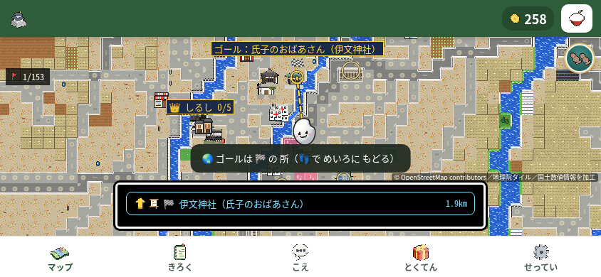
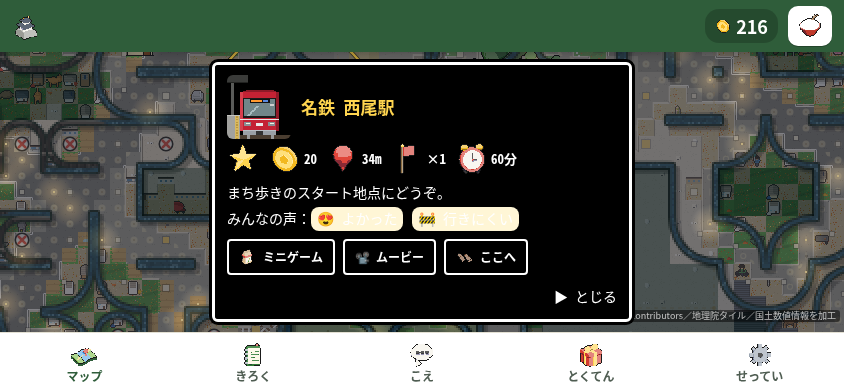

# 第89周：通常手本を押したときの世界地図への移動

公開用のコードcommitは `c5c6cebc1e84f5fef8ee076e1e8020929494d0c2`。検証したローカルcommit `1fb111a648b2d9aa20fcd4209dd76e3308263c5a` とコード全体のtree `b50818570f17ae91f43fa42f57342abeca0ba88f`・親commit・メッセージ・日時が同じです。GitHubのメール保護に合わせ、未公開commitのメール表記だけを匿名形式へ変更しました。全体テストを別のコードで実行したものではありません。

通常の手本の中央を押して歩こうとした操作で、世界地図へ移る現象を確認した。最初の1分に手本を信じて歩けない離脱候補として、動いている手の中央を含めて配置を調べる既存案に固定したmain `ab12150f` の変更を取り込んだ候補を再確認した。固定10回で世界地図へ移った試行は10/10→0/10。ただし施設情報パネルは2→32回開き、候補の全10試行に残る。離脱率は測定していない。

通しテスト失敗のためdraft・マージ保留。候補 `1fb111a648b2d9aa20fcd4209dd76e3308263c5a`、固定した比較main `ab12150f581df7908dc1df2c51f4a035ecd88bbb`、既存PR #1133の旧head `9fa4e2b7d15ae1e1d88e8506bcc3532ff3509ed9`。全unittestは実終了1で68失敗・1エラー。必須ブラウザー全体テストも実終了1で13群が明示失敗。全体成功やマージ可とは扱わない。

検証中にmainは `85400c84dd68268120aa4aa27eb96c33758f9011` へ進み、米づくり365のREADME・画面・テストの3ファイルが更新された。第89周の比較基準は `ab12150f`、候補と全体テスト用の複製は `1fb111a6` に固定したまま。この記録を `85400c84` でのテスト結果とは扱わない。

## 変更と再現

製品差分は固定main `ab12150f` に対して `nishio-go/pixel.js` の25行追加・削除0。`tapDemoLayout`（9575行）は通常手の動き途中の中央を既存の歩行判定で検査し、`tapDemoSpot`（9650行）は既存の候補で通常手を置けない場合だけ、18pxの余裕を保つ4つの中間点も探す。初回許可待ちのfirst/big、slop0、既存候補の優先順は維持する。固定main `ab12150f` の304テストファイルと、既存PRの追加2テストはbyte単位で維持した。テストの場所は `tests/test_nishio_moving_hand.py:89`、`:112`、`:138`、`tests/test_nishio_hand_midpoints.py:208`。

1. 比較対象のリポジトリ最上位で `python3 -m http.server 8000` を起動し、Chromiumで `http://localhost:8000/nishio-go.html` を開く。
2. 844×390、isMobile/hasTouch、CPU rate4。Leaflet1.9.4のCSS/JS/imagesを手元のファイルへrouteし、他の外部通信を遮断する。
3. 新しいブラウザーの試行で状態・seedを変更せず10秒観察。その後60秒、画面に見える手本の中央へCDP `Input.dispatchTouchEvent` でtouchStart/touchEnd。世界地図や施設情報が開いたら見える戻る/閉じるを使い、同じ方針で続ける。
4. 主観察は40msを前後1回ずつ。補足再現は40/250msの送信予約値を交互に各5回、固定10試行を直列で実行。実配送・ACK・event時刻は別に保存。未成立の差し替えなし。観察10秒、プレー開始後10/30/60秒の原画を保存し、実送信・ACK・trusted event・反応を区別する。

「通常手」はfirst/wbを除外した既存分類。世界地図への移動の実観測は次の入力または60秒までに限定し、1100msの完全窓と別に数える。完全窓のない最後の入力を、無反応確定へ置換しない。CPU4は実機速度への校正値ではない。

## 固定10回の主指標

|保持|世界地図へ移った試行 前→後|世界地図へ移った操作/通常手入力 前→後|施設情報表示 前→後|
|---|---|---|---|
|40ms|5/5→0/5|71/91→0/75|0→22|
|250ms|5/5→0/5|17/65→0/69|2→10|
|全10|10/10→0/10|88/156→0/144|2→32|

前253入力／後185入力。完全窓246→178、未完窓7→7、完全窓無反応0→0、未完で反応未観測1→1。CDP ACKは506/506→370/370、trusted eventは759/759→555/555、コンソール・ページエラーは両側0。全20試行でソース一致・CPU4→1への復帰・ブラウザー終了を照合し、各側9つの直列境界を確認。前後80原画を実見した。

変更前の試行10の最後は送信59.863→down60.066→解除60.113→完了60.359秒。変更後の試行10の最後は送信59.648→down59.8763→解除59.899→完了60.233秒。いずれも60秒内反応未観測・未完のまま保持。入力配送の確認と反応窓を分け、期限後の反応を追加していない。

## 主観察1回ずつ（固定10回とは別）

|指標|前|後|
|---|---:|---:|
|入力／通常手|20／15|23／16|
|世界地図／施設情報表示|5／0|0／7|
|CDP送信→座標変化を観測した上限|470.9ms|430.0ms|
|初めて見えた30点（プレー開始後）|1.0888秒|1.0391秒|
|CDP送信→30点を観測した上限|967.8ms|895.1ms|
|最初の保存到達数変化|26.2154秒|33.5715秒|
|完全窓／未完|19／1|22／1|

単発の速度差を修正の効果としない。時間はCDP送信と既存観測器の記録に基づく上限で、本物の指の接触時刻や描画時刻ではない。前60秒原画は世界地図、後60秒原画は西尾駅の情報パネル。後の施設情報表示も隠さず掲載する。

原画を無加工・同一byteでコピー。前SHA256 `9f94a45ea0cfb29f73412424090373ec9cb398dbeb077f1cf8986a79a6cc6a36`、後SHA256 `26d0f135638a48d53f7a3153aaebfed5c7a69b3f15b077f9cc93ead3280c0f41`。

## 後付け補助集計（事前の世界地図への移動という主指標とは別）

通常手操作で世界地図または施設情報へ進んだものを重複除外すると、40msは71/91→22/75、250msは19/65→10/69、全体90/156→32/144。両方に該当した操作は前後とも0。どちらかが起きた試行は前後とも10/10で、別表示への移行は残る。全ての施設情報表示が意図外・世界地図への移動と同じ重大さだとは、この集計だけでは決めない。

初の可視正点は前後10/10に観測（プレー開始後、変更前0.7573–3.6203秒／変更後0.8994–1.3038秒）。保存された到達数が1以上の状態は前4/10（観測分22.1409–31.3564秒、他6は60秒内未観測）、後10/10（28.0096–38.0291秒）。到達数を観測した試行4→10は後付けの保存値観測であり、表示完了・人の継続・離脱率ではない。未観測を0秒や永久未達に置き換えない。乱数・経路・露出回数が異なり、これらから因果的な全体改善は主張しない。

## 画面サイズとテスト

320×568・390×844・568×320・844×390・820×1180を前後で確認。各側20状態／130操作部／20入力、25原画（計50枚）を担当者が実見し、両側の実終了0。操作部の配置・スクロール・手本以外の目印に差はなく、観察した範囲で新たなはみ出し・操作部中央の押下不可・重なりは確認されませんでした。手本の幾何差9件は別に保持。568×320の地図から戻った場面で案内と中央ナビゲーションが重なる既存表示は両側にあり、今回解消したとはしない。

回帰テストは同じファイルを使い、環境変数 `NISHIO_SOURCE_ROOT` だけを固定main `ab12150f` →候補へ切り替えた。実コマンドは `python3 tests/test_nishio_moving_hand.py` と `python3 tests/test_nishio_hand_midpoints.py`（実行時の絶対パス・時刻・SHAはround89-results.json）。REDは3methodsで失敗記録5件（subTest失敗3＋別2method失敗）と、1methodで1失敗、各exit1。GREENは3＋1methods成功、各exit0。テスト削除・緩和・停止なし。幾何fixtureや互換性の確認であり、全ての実地形・本物の指の安全を証明しない。

`pytest tests/` は実終了127。実エラーは `bash: line 1: pytest: command not found`。pytestによるテストは実行できなかった。

- 全unittest：`python3 -m unittest discover -s tests -v` は実終了1、2572methods＝2502成功・68失敗・1エラー・1skip、524.6秒。実行元と検証用の複製は前後不変。独立監査では第69周の69失敗見出しと種別・名前・例外型・順序が一致し、追加/消失した見出しは0。ただし例外メッセージ31件に差があり、同じ原因・無視できる失敗とはしない。記録上の分類は変更ファイルallowlistのassertion65、pixel export文字列assertion2、トラクター進捗文字列assertion1、正規表現不一致後のgroup参照AttributeError1。回帰4methodsとmainの追加起動条件11methodsは明示OK。失敗名・skip・独立監査SHAはround89-results.json。
- 必須ブラウザー全体テスト：`node tools/playtest.js` は実終了1。2026-11-13 13:09:32.562–13:41:54.744 UTC、直下250チェック群＝明示成功217・明示失敗13・明示判定なし20。候補と検証用の複製は前後不変。`firstDemoFast`・`demoTouchWait` は明示成功、`rollNoDemo` は明示失敗。実コマンドの記録先引数・環境・全失敗値・原本SHAはround89-results.json。

失敗13項目：`roll`、`swipeHold`、`a2hsAutoHide`、`tapDemoQuick`、`rollNoDemo`、`lowGoalDemo`、`bootSlow`、`infoRotate`、`lowDemoKept`、`restFinger`、`tiltDemoShown`、`godotRec`、`speedLines`。

この集計は `checks` の直下1プロパティを1群として、値自体または直下の `ok` が真偽値かで区別した。内部の真偽値・部分ケースを件数に足さず、明示判定なし20群を成功・失敗・未実行と決めない。収集対象の `errors[]` は0で、全コンソールや全通信の無エラーを意味しない。`scriptStopped`・クラッシュ記録は見つからず、最終結果JSONと実終了1を回収した。通常経路では最終結果前にブラウザー終了を待つ構成だが、サーバー終了のawaitや追加のプロセス・socket確認はこの監査で行っていない。

通しテストは固定した状態・日時を使う回帰検証で、自然に最初の60秒を遊ぶ試行とは別。第69周は247群＝215成功・12失敗・20判定なし。今回は3群追加（`firstDemoFast`・`demoTouchWait` は成功、`rollNoDemo` は失敗）、既存群の `a2hsAutoHide`・`bootSlow` は成功→失敗、`infoSecondTap`・`tapWalkTilt` は失敗→成功。製品と検証コードのSHAが異なる独立した実行なので、同じ失敗名や判定の変化から原因・修正効果・全体成功を結論しない。基準 `ab12150f`・候補 `1fb111a6` の記録であり、更新後main `85400c84` で試験したものではない。

全unittestが落ちているため、[ricepia-flowの212行](../../../.claude/skills/ricepia-flow/SKILL.md#L212) の指示（「テストが 落ちている」変更は「マージせずに 伝える」）に従ってマージを保留する。

## 運営者の判断・未確認

最初の本当のタップでclickから傾き許可を1回聞くこと、既に断った人への扱い、許可前の手本、停止中の手本、始まり画面なし・到着カードなしを維持する。施設情報が開く残存挙動は未解決の候補として記録し、この案では変更していない。傾きセンサー、本物の指、実回線、実機速度、実プレーヤーの離脱率は未確認。

証拠の集計・原本SHAは[round89-results.json](round89-results.json)。過去の条件は[第69周](round69-README.md)・[第65周](round65-README.md)に保持し、今回の値へ混ぜない。
